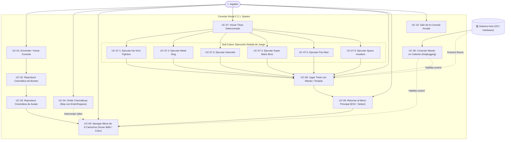
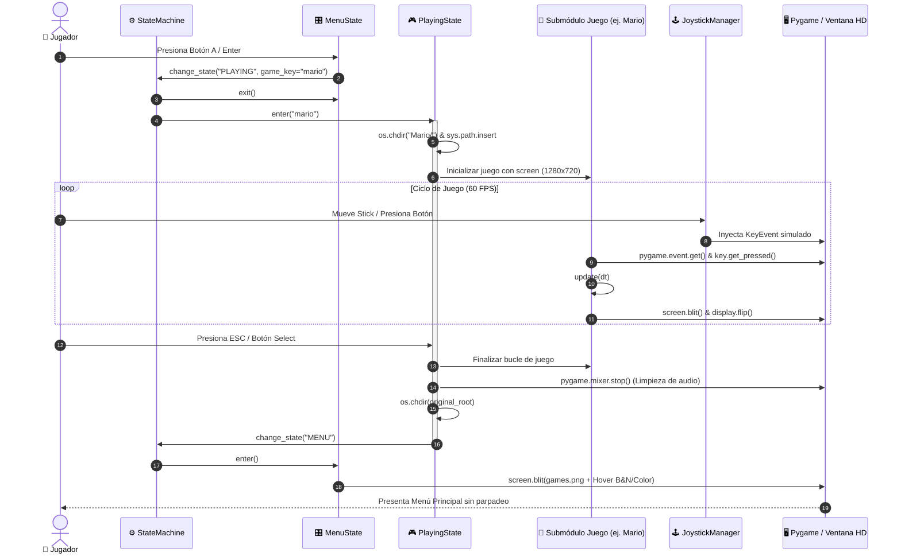

# Diagramas de Casos de Uso y Modelado de Comportamiento
## Proyecto: C.C.I. SYSTEM (Virtual Arcade Console Platform)
**Documento:** Modelado UML de Casos de Uso y Secuencias  
**Versión:** 2.0.0  

---

## 1. Identificación y Caracterización de Actores

```
                 ┌────────────────────────────────────────────────────────┐
                 │                        ACTORES                         │
                 └────────────────────────────────────────────────────────┘
                                      │
                 ┌────────────────────┴────────────────────┐
                 ▼                                         ▼
       ┌───────────────────┐                     ┌───────────────────┐
       │      JUGADOR      │                     │   SISTEMA HOST    │
       │  (Actor Primario) │                     │ (Actor Secundario)│
       └───────────────────┘                     └───────────────────┘
```

1. **Jugador (Player - Primario):**
   * Persona física que interactúa con el sistema a través del teclado físico o un controlador de juegos (gamepad).
   * Tiene como objetivos: ver las presentaciones, navegar la galería de títulos, jugar y alternar entre los diferentes juegos sin fricción.
2. **Sistema Host (Secondary / System Actor):**
   * Capa de hardware y sistema operativo que suministra los eventos de entrada (USB, Bluetooth), el reloj de sincronización, la memoria y los dispositivos de salida de audio y video.

---

## 2. Diagrama de Casos de Uso General (UML Mermaid)



---

## 3. Especificaciones Extensas de Casos de Uso

### Caso de Uso: UC-05 - Navegar Menú con Efecto Hover Cromático
* **Identificador:** UC-05
* **Nombre:** Navegar Menú de Cartuchos con Efecto Hover Puro
* **Actores:** Jugador.
* **Propósito:** Permitir al usuario explorar los 6 títulos visualmente en la cuadrícula 2x3 con respuesta inmediata visual y sonora.
* **Precondiciones:** La consola se encuentra en el estado `MENU` desplegando la imagen de fondo `games.png`.
* **Flujo Principal (Básico):**
  1. El sistema renderiza el fondo de la consola a 1280x720 centrado.
  2. El sistema dibuja las 6 tarjetas de juego: la que tiene el foco actual se muestra con el recorte a color de `cards-color.jpeg`, y las otras 5 se muestran en escala de grises de `cards-bn.jpeg`.
  3. El jugador presiona una tecla direccional (`Flechas`, `WASD`) o mueve la cruceta / stick analógico de su gamepad.
  4. El `JoystickManager` traduce la acción y emite el evento correspondiente.
  5. El sistema recalcula la posición `(fila, columna)` dentro de la matriz 2x3:
     * Si presiona Derecha en la columna 2, pasa a la columna 0 de la misma fila.
     * Si presiona Abajo en la fila 1, pasa a la fila 0 de la misma columna.
  6. El sistema emite un tono de audio sintético suave a 600 Hz.
  7. El sistema actualiza inmediatamente la pantalla: la tarjeta previa vuelve a blanco y negro y la nueva tarjeta seleccionada se pinta a todo color sin parpadeos.
* **Postcondiciones:** El índice de juego seleccionado queda listo para ser lanzado.

---

### Caso de Uso: UC-07.2 - Ejecución Aislada de Metal Slug
* **Identificador:** UC-07.2
* **Nombre:** Lanzamiento y Ejecución sin Tearing de Metal Slug
* **Actores:** Jugador, Sistema Host.
* **Propósito:** Ejecutar el juego de acción arcade de Neo-Geo dentro de la misma ventana de 1280x720 sin pérdida de cuadros ni artefactos visuales.
* **Precondiciones:** El cartucho `Metal Slug` (Fila 0, Columna 1) está seleccionado y el jugador presiona `Enter`, `Espacio` o `Botón A`.
* **Flujo Principal (Básico):**
  1. El estado `MENU` reproduce el tono de confirmación sonoro a 900 Hz y transiciona a `PLAYING(game_key="metalslug")`.
  2. `PlayingState` almacena el directorio actual (`original_cwd = os.getcwd()`).
  3. El sistema cambia el directorio de trabajo a `METAL SLUG/` e inserta la ruta en `sys.path`.
  4. El sistema purga la instancia singleton de `SoundManager` (`SoundManager._instance = None`) y vuelve a instanciarlo para que resuelva los archivos WAV/OGG correctamente.
  5. El sistema intercepta `pygame.display.set_mode` para devolver la superficie `screen` única existente de 1280x720.
  6. Se instancia `MetalSlugGame()`.
  7. El sistema sobrescribe el método `ms_instance.draw` con una rutina adaptada (`presentation_draw`) que:
     * Ejecuta el pipeline interno de dibujado de entidades hacia la superficie virtual nativa Neo-Geo (320x224).
     * Suprime el `pygame.display.flip()` original de Metal Slug.
     * Escala suavemente la superficie virtual a la altura completa de 720 píxeles (`scaled_w ≈ 1028 px`) y la centra en la ventana con barras negras laterales (`offset_x ≈ 126 px`).
     * Realiza un **único `pygame.display.flip()`** sincronizado.
  8. El bucle de Metal Slug se ejecuta a 60 FPS fijos.
  9. El jugador controla al personaje mediante el gamepad o teclado.
* **Flujo de Retorno (Excepción / Salida):**
  1. El jugador presiona la tecla `ESC` o el botón `Select/Share` del mando.
  2. `ms_instance.is_running` pasa a `False`.
  3. El bloque `finally` detiene todos los canales de audio de `pygame.mixer`, restaura el directorio de trabajo raíz de la consola y cambia el estado de la máquina a `MENU`.
* **Postcondiciones:** El usuario vuelve al menú principal en la misma ventana sin fugas de memoria ni residuos de audio.

---

## 4. Diagrama de Secuencia: Lanzamiento y Retorno de un Juego (Mermaid)


