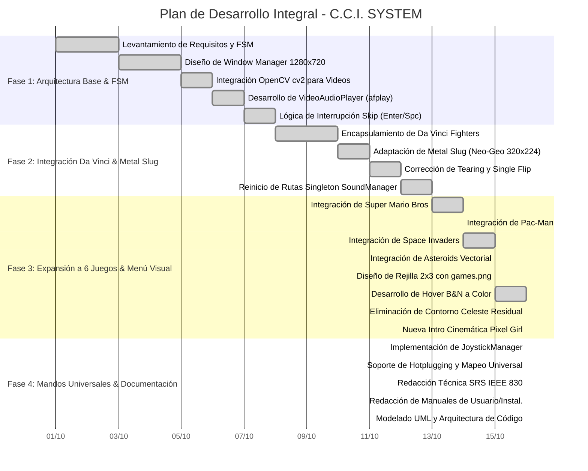

# Cronograma de Proyecto, Gestión y Diagrama de Gantt
## Proyecto: C.C.I. SYSTEM (Virtual Arcade Console Platform)
**Documento:** Gestión de Tiempos, Tareas y Planificación  
**Versión:** 2.0.0  

---

## 1. Metodología de Gestión del Proyecto

El desarrollo de **C.C.I. SYSTEM** se ejecutó bajo una adaptación del marco de trabajo ágil **Scrum**, articulado en **Sprints semanales** enfocados en la entrega continua de valor y la mitigación temprana de riesgos técnicos (como problemas de dependencias nativas SDL2 en macOS, gestión de buffers de sonido en procesos paralelos y compatibilidad de mandos).

```
┌─────────────────────────────────────────────────────────────────────────────┐
│                       CICLO DE DESARROLLO DEL PROYECTO                      │
├───────────────────┬───────────────────┬───────────────────┬─────────────────┤
│     SPRINT 1      │     SPRINT 2      │     SPRINT 3      │    SPRINT 4     │
│   (Arquitectura)  │  (DaVinci/MSlug)  │   (6 Cartuchos)   │(Joysticks/Docs) │
├───────────────────┼───────────────────┼───────────────────┼─────────────────┤
│ • FSM Core        │ • Encapsulado DF  │ • 4 Nuevos Juegos │ • Hotplug Joy   │
│ • Window HD 720p  │ • Pipeline MSlug  │ • Grid 2x3 Menú   │ • Intercept Key │
│ • Video + afplay  │ • Fix Tearing     │ • Hover B&N/Color │ • Intro Cami HD │
│ • Skip en Videos  │ • Singleton Sound │ • Cleanup Frames  │ • Suite Docs    │
└───────────────────┴───────────────────┴───────────────────┴─────────────────┘
```

---

## 2. Diagrama de Gantt Integral (Mermaid)

El siguiente diagrama cronológico ilustra el desglose de tareas, precedencias y tiempos de ejecución del proyecto:



---

## 3. Matriz de Tareas, Responsables y Criterios de Aceptación (WBS)

| Código | Tarea / Entregable | Duración | Dependencia Previa | Criterio de Aceptación y Validación |
| :--- | :--- | :--- | :--- | :--- |
| **WBS 1.1** | Inicializador de Estados `states.py` | 2 días | N/A | Transición limpia entre clases derivadas de `BaseState`. |
| **WBS 1.2** | Renderizador OpenCV con Audio | 3 días | WBS 1.1 | `CCI_INTRO.mp4` se reproduce a 30 FPS sin lag de audio. |
| **WBS 2.1** | Adaptación Gráfica de Metal Slug | 2 días | WBS 1.2 | Neo-Geo se escala a 1280x720 sin estirar proporciones. |
| **WBS 2.2** | Eliminación de Tearing en Metal Slug | 1 día | WBS 2.1 | Se elimina la llamada duplicada a `display.flip()`. |
| **WBS 3.1** | Inclusión de Mario, Pacman, Space, Asteroids | 2 días | WBS 2.2 | Los 4 juegos arrancan en la misma ventana con audio. |
| **WBS 3.2** | Menú Arcade Rejilla 2x3 con Hover | 1 día | WBS 3.1 | Cartucho inactivo en B&N y cartucho enfocado a color. |
| **WBS 3.3** | Integración Video Cinemático Pixel Girl | 0.5 días | WBS 3.2 | Nuevo video con sonido reemplaza la intro previa. |
| **WBS 4.1** | Módulo `JoystickManager` | 1 día | WBS 3.3 | Mandos PS5/Xbox/Switch operan en los 6 juegos. |
| **WBS 4.2** | Suite Documental Completa (8 Documentos) | 1 día | WBS 4.1 | Documentación técnica exhaustiva lista para entrega. |

---

## 4. Gestión de Riesgos y Mitigaciones Implementadas

```
┌─────────────────────────────────────────────────────────────────────────────┐
│                            MATRIZ DE RIESGOS                                │
├───────────────────────────────────┬──────────────┬──────────────────────────┤
│             RIESGO                │   IMPACTO    │   MITIGACIÓN APLICADA    │
├───────────────────────────────────┼──────────────┼──────────────────────────┤
│ 1. Colisión de librerías dylib    │ Crítico      │ Supresión a nivel de     │
│    SDL2 en macOS.                 │ (Cuelgues)   │ descriptor os.dup2 en    │
│                                   │              │ el arranque temprano.    │
├───────────────────────────────────┼──────────────┼──────────────────────────┤
│ 2. Tearing en Metal Slug por      │ Alto         │ Interceptación de        │
│    doble renderizado de pantalla. │ (Flickering) │ ms_instance.draw para un │
│                                   │              │ único flip por frame.    │
├───────────────────────────────────┼──────────────┼──────────────────────────┤
│ 3. Juegos diseñados sólo para     │ Alto         │ Inyección de eventos y   │
│    teclado ignoran los gamepads.  │ (Injugable)  │ ScancodeWrapper sobre    │
│                                   │              │ pygame.key.get_pressed.  │
├───────────────────────────────────┼──────────────┼──────────────────────────┤
│ 4. Desalineación de audio al      │ Medio        │ Limpieza de canales con  │
│    salir de un juego con ESC.     │ (Ruido/Bug)  │ pygame.mixer.stop() en   │
│                                   │              │ el bloque finally.       │
└───────────────────────────────────┴──────────────┴──────────────────────────┘
```
