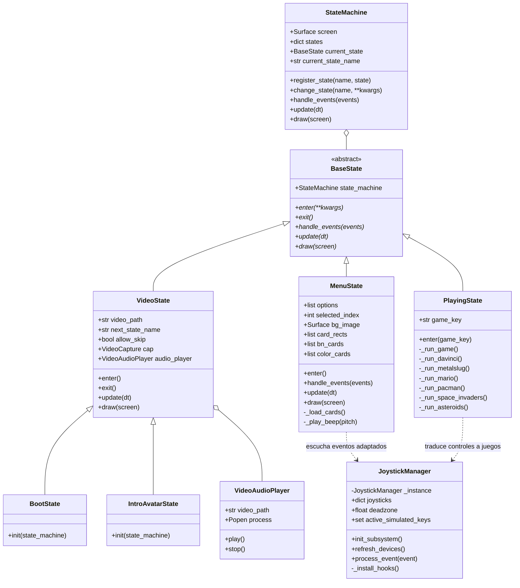
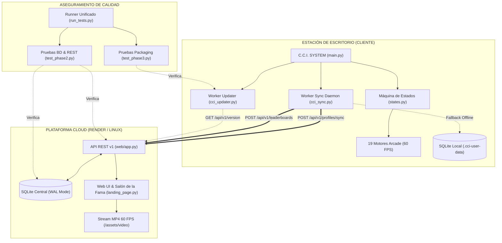

# Arquitectura de Software y Código Fuente
## Proyecto: C.C.I. SYSTEM (Virtual Arcade Console Platform)
**Documento:** Especificación Técnica de Arquitectura, Módulos y Código Fuente  
**Versión:** 2.1.0 (Ecosistema Completo: Cloud Database, REST API v1, Auto-Updater & Testing CI/CD)  

---

## 1. Patrones de Diseño Aplicados

La robustez de **C.C.I. SYSTEM** radica en la selección deliberada y aplicación estricta de patrones de diseño de software reconocidos por la industria (GoF - Gang of Four):

```
┌─────────────────────────────────────────────────────────────────────────────┐
│                       PATRONES DE DISEÑO EN C.C.I. SYSTEM                   │
├───────────────────────┬─────────────────────────────────────────────────────┤
│ PATRÓN                │ APLICACIÓN CONCRETA EN EL PROYECTO                  │
├───────────────────────┼─────────────────────────────────────────────────────┤
│ 1. State Pattern      │ Desacoplamiento total del flujo de la consola:      │
│    (State Machine)    │ BootState -> IntroAvatarState -> MenuState ->       │
│                       │ PlayingState sin dependencias circulares.           │
├───────────────────────┼─────────────────────────────────────────────────────┤
│ 2. Singleton Pattern  │ JoystickManager y SoundManager operan como          │
│                       │ instancias únicas globales para evitar reinicios    │
│                       │ múltiples del subsistema de mandos y audio.         │
├───────────────────────┼─────────────────────────────────────────────────────┤
│ 3. Proxy / Adapter    │ JoystickManager intercepta pygame.event.get y       │
│                       │ pygame.key.get_pressed, adaptando la entrada de     │
│                       │ gamepads físicos a eventos de teclado transparentes.│
├───────────────────────┼─────────────────────────────────────────────────────┤
│ 4. Template Method    │ BaseState define la estructura abstracta del ciclo  │
│                       │ de vida: enter(), exit(), handle_events(),          │
│                       │ update() y draw().                                  │
└───────────────────────┴─────────────────────────────────────────────────────┘
```

---

## 2. Diagrama de Arquitectura de Módulos (Mermaid)



---

## 3. Desglose Técnico de los Componentes del Código Fuente

### 3.1. [main.py](../main.py)
* **Propósito:** Actúa como el Kernel / Launcher de la consola virtual.
* **Aspectos Técnicos Destacados:**
  * **Orden de Importación:** Importa `states` antes de `pygame` para que el supresor de descriptores de archivo de bajo nivel silencie los avisos de Objective-C antes de que las librerías dinámicas se carguen en memoria.
  * **Inicialización Central:** `init_subsystems()` ejecuta `pygame.init()`, `font.init()`, `mixer.init(44100, -16, 2, 512)` y `joystick.init()`.
  * **Ciclo Maestro:**
    ```python
    clock = pygame.time.Clock()
    while running:
        dt = clock.tick(FPS) / 1000.0
        events = pygame.event.get()
        # Captura global de cierre de ventana y salida con ESC
        for event in events:
            if event.type == pygame.QUIT:
                running = False
            elif event.type == pygame.KEYDOWN and event.key == pygame.K_ESCAPE:
                if state_machine.current_state_name == "MENU":
                    running = False
        state_machine.handle_events(events)
        state_machine.update(dt)
        state_machine.draw(screen)
        pygame.display.flip()
    ```

---

### 3.2. [states.py](../states.py): Módulos Clave

#### A. Capa de Periféricos: `JoystickManager`
* **Problema Resuelto:** Los juegos clásicos de Python estaban diseñados para leer el teclado físico. Los mandos USB eran completamente ignorados.
* **Implementación:**
  * Al inicializarse, instala un *Hook* sobre `pygame.key.get_pressed`:
    ```python
    orig_get_pressed = pygame.key.get_pressed
    class ScancodeWrapper:
        def __init__(self, base_keys): self.base_keys = base_keys
        def __getitem__(self, key):
            if key in active_keys: return 1
            return 1 if self.base_keys[key] else 0
        def __len__(self): return len(self.base_keys)
    pygame.key.get_pressed = lambda: ScancodeWrapper(orig_get_pressed())
    ```
  * Intercepta `pygame.event.get()`, procesa los eventos `JOYAXISMOTION` (sticks analógicos con zona muerta 0.35), `JOYHATMOTION` (cruceta D-pad) y `JOYBUTTONDOWN` / `JOYBUTTONUP`, e inyecta eventos virtuales `KEYDOWN`/`KEYUP` directamente en la cola de Pygame.

#### B. Motor de Video y Audio: `VideoState` y `VideoAudioPlayer`
* **Problema Resuelto:** OpenCV solo procesa pistas de video sin sonido y corre al máximo de CPU si no se sincroniza con el reloj real.
* **Implementación:**
  * `VideoAudioPlayer` invoca el reproductor nativo del sistema operativo (`afplay` en macOS) en un subproceso desacoplado `subprocess.Popen`, deteniéndolo con `.terminate()` al salir o saltar el video.
  * `VideoState.update()` calcula `target_frame = int((time.perf_counter() - start_time) * fps)`. Lee cuadros hasta alcanzar el cuadro objetivo y convierte el frame de BGR a RGB, generando la superficie de dibujo con `pygame.image.frombuffer()`.

#### C. Menú Arcade Interactivo: `MenuState`
* **Problema Resuelto:** Evitar la distorsión del arte original `games.png` (1452x1083) en pantallas 16:9 de 1280x720 y presentar un efecto hover visual impecable.
* **Implementación:**
  * Calcula el factor de escala: `scale = 720.0 / 1083.0` (`scaled_w ≈ 965 px`), centrando horizontalmente la imagen con `offset_x = (1280 - 965) // 2 ≈ 157 px`.
  * **Carga de Cartuchos:** En `_load_cards()`, recorta mediante subsurfaces las 6 tarjetas de `cards-bn.jpeg` y `cards-color.jpeg` (2400x1792). Con `pygame.surfarray`, detecta los píxeles blancos del fondo exterior en las esquinas redondeadas (`r > 230 and g > 230 and b > 230`) y les asigna transparencia alfa (`alpha = 0`).
  * **Renderizado:** Dibuja las 5 tarjetas inactivas en escala de grises y superpone la tarjeta seleccionada a todo color sin cajas celestes invasivas.

#### D. Aislador de Entorno de Juegos: `PlayingState`
* **Problema Resuelto:** Cada juego tenía rutas relativas a sus carpetas locales y dependencias que colisionaban.
* **Implementación:**
  * Almacena el directorio original con `original_cwd = os.getcwd()`.
  * Cambia al directorio del juego con `os.chdir()` e inserta la ruta al inicio de `sys.path`.
  * **En Metal Slug:** Sobrescribe `ms_instance.draw()` para anular el doble flip y adaptar el renderizado virtual de Neo-Geo (320x224) a 1280x720 con un solo `display.flip()` sincronizado.
  * **En el bloque `finally`:** Detiene la música con `pygame.mixer.music.stop()` y purga los canales con `pygame.mixer.stop()`, garantizando que al regresar al menú no queden sonidos residuales en bucle.

---

### 3.3. Módulo Web Oficial & Despliegue en la Nube ([web/app.py](../web/app.py), [run_web.py](../run_web.py))
* **Arquitectura 100% Python:** Diseñada sin archivos HTML, CSS ni plantillas externas en disco.
* **Generación Dinámica ([web/landing_page.py](../web/landing_page.py)):** Sintetiza en memoria la interfaz Cyberpunk completa, estilos CSS responsivos y scripts cliente para filtros por categoría, modales de ficha técnica y navegación.
* **Desacoplamiento de Datos ([catalog_data.py](../catalog_data.py)):** Extrae los metadatos de los 19 juegos sin depender de librerías nativas compiladas de Pygame/OpenCV, permitiendo que la web se ejecute de forma ultraligera en la nube (Render.com) con consumo mínimo de RAM (~35 MB).
* **Redirección CDN de Descargas:** Las rutas `/download/mac` y `/download/windows` comprueban si existen instaladores locales o redirigen automáticamente mediante HTTP 302 a los binarios alojados en GitHub Releases, asegurando descargas a alta velocidad sin saturar el servidor web.

---

### 3.4. Motor de Distribución Multiplataforma ([build_distribution.py](../build_distribution.py))
* **macOS DMG:** Construye una imagen de disco nativa Apple Disk Image (`.dmg`) mediante `hdiutil` en formato `UDZO` comprimido, con bundle `C.C.I. SYSTEM.app`, archivo `PkgInfo`, firma ad-hoc con `codesign` y asistente de instalación interactivo con destino en el Escritorio.
* **Windows EXE:** Genera un instalador ejecutable GUI nativo PE32 de 1-clic con cabecera SFX de 7-Zip, extrayendo el contenido y creando el acceso directo en el Escritorio sin necesidad de terminales ni prompts de comandos.
* **Optimización de Cargas:** Excluye volcados temporales, cachés binarios y archivos no esenciales, reduciendo el tamaño del paquete de distribución de 2.8 GB a 734 MB en macOS y 628 MB en Windows.
* **Integridad de Fábrica:** Garantiza **0 perfiles precargados** en la distribución final para que cada nuevo jugador inicie su perfil desde cero.

---

### 3.5. Capa de Persistencia Relacional SQLite ([cci_database.py](../cci_database.py))
* **Motor 100% Python Nativo:** Implementado íntegramente con la librería estándar `sqlite3`, eliminando cualquier dependencia de drivers binarios o servicios externos.
* **Concurrencia y Robustez:**
  * Modo **WAL (Write-Ahead Logging)** habilitado por defecto (`PRAGMA journal_mode = WAL`), permitiendo lecturas concurrentes sin bloqueo durante escrituras intensivas.
  * Claves foráneas activas (`PRAGMA foreign_keys = ON`) con borrado y actualización en cascada (`ON DELETE CASCADE`).
  * Conexiones thread-safe gestionadas mediante context manager seguro `get_db()` y cerrojo reentrante `threading.RLock()`.
* **Esquema Relacional:**
  * `games`: Catálogo oficial de los 19 títulos con metadatos técnicos, categorías JSON y slots asignados.
  * `profiles`: Perfiles de jugador independientes con identificador slug, tiempo acumulado y nivel XP.
  * `game_stats`: Estadísticas individualizadas por juego y perfil (segundos jugados, lanzamientos, porcentaje de progreso).
  * `highscores`: Marcadores arcade globales indexados (`idx_highscores_game`) para consultas instantáneas en el podio.
  * `achievements_unlocked`: Registro relacional de trofeos y logros desbloqueados por jugador.

---

### 3.6. Arquitectura de Servicios REST v1 ([web/app.py](../web/app.py))
* **Especificación de Endpoints:**
  * `GET /api/v1/health`: Diagnóstico del estado del backend, telemetría y salud del motor SQLite.
  * `GET /api/v1/stats`: Métricas globales del ecosistema (total de juegos, tiempo acumulado, jugadores y récords).
  * `GET /api/v1/games`: Catálogo completo estructurado con serialización JSON.
  * `GET /api/v1/games/<game_id>`: Ficha técnica y podio Top 5 del título consultado.
  * `GET /api/v1/leaderboards`: Consulta del Salón de la Fama con soporte para filtros por juego (`?game_id=...`) y paginación (`?limit=...`).
  * `POST /api/v1/leaderboards`: Registro y validación estricta de nuevas puntuaciones arcade.
  * `GET /api/v1/profiles` y `GET /api/v1/profiles/<profile_id>`: Consulta y detalle de perfiles sincronizados.
  * `POST /api/v1/profiles/sync`: Endpoint de sincronización bidireccional no destructiva de perfiles y trofeos.
  * `GET /api/v1/version`: Entrega de metadata canónica de versión para el auto-actualizador.

---

### 3.7. Cliente de Sincronización Asíncrona Desacoplada ([cci_sync.py](../cci_sync.py))
* **Aislamiento del Bucle Temporal de Juego:**
  * Cualquier envío de perfil o récord arcade se ejecuta en un hilo `threading.Thread(..., daemon=True)` independiente.
  * El loop principal de Pygame mantiene **60 FPS constantes** sin experimentar latencia I/O de red.
* **Tolerancia a Fallos y Modo Offline:**
  * Intenta sincronizar contra la API REST mediante peticiones HTTP estructuradas con timeout corto (1.5 s).
  * Si el servidor web no está en ejecución o la estación no tiene conexión a internet, conmuta automáticamente a **persistencia directa en la base de datos SQLite local**.

---

### 3.8. Sistema de Versionado Canónico & Auto-Actualizador ([cci_updater.py](../cci_updater.py) & [version.json](../version.json))
* **SemVer 2.0.0 Puro:**
  * Parser semántico `parse_semver()` y función determinista `is_newer_version()`.
* **Verificación Silenciosa:**
  * Inspección en segundo plano (`check_for_updates_background`) al arrancar la consola.
  * Alerta de disponibilidad de release sin interrumpir la partida en curso.
* **Badge Dinámico de Sistema:**
  * Refleja la versión en tiempo real en la pantalla de Ajustes y en el HUD de la consola.

---

## 4. Diagrama del Ecosistema Integral C.C.I. SYSTEM



---

## 5. Aseguramiento de Calidad y Suite de Pruebas Automatizadas

El proyecto incorpora un sistema de verificación formal ejecutable mediante `./run_tests.py`:

```bash
# Ejecución completa de la suite de pruebas
.venv/bin/python run_tests.py
```

### Cobertura de Pruebas:
1. **Fase 2 (Persistencia & Servicios REST):**
   * Inicialización determinista y migración de semillas arcade (19 títulos oficiales).
   * Inserción, ordenamiento y recuperación de récords con índices de alta velocidad.
   * Upsert de perfiles multiusuario, acumulación de tiempo y cálculo de nivel XP.
   * Diagnóstico de salud HTTP (`/api/v1/health` y `/api/v1/stats`).
   * Validación de payloads en registros de puntuaciones (código HTTP 201 y 400).
   * Sincronización desacoplada en hilo `daemon`.
   * Renderizado en memoria del Salón de la Fama y atributos de accesibilidad.

2. **Fase 3 (Empaquetado & Auto-Updater):**
   * Validación estructural del manifiesto canónico `version.json`.
   * Análisis y comparación estricta de versiones según especificación SemVer.
   * Endpoint de metadatos de versión (`/api/v1/version`).
   * Comprobación síncrona y asíncrona de actualizaciones.
   * Filtros de exclusión de binarios, volcados y bases de datos en empaquetado de producción.
   * Garantía de fábrica de 0 perfiles de usuario.
