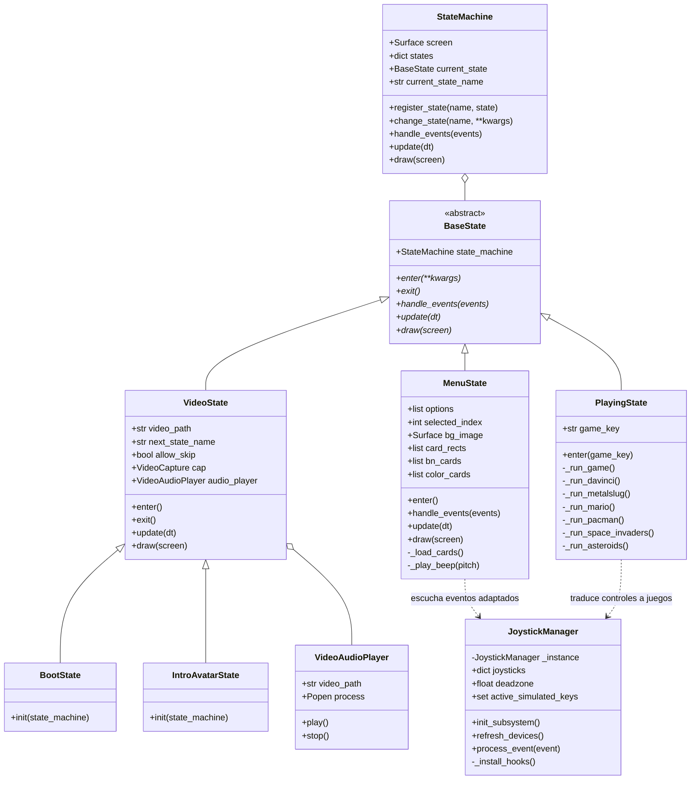

# Arquitectura de Software y Código Fuente
## Proyecto: C.C.I. SYSTEM (Virtual Arcade Console Platform)
**Documento:** Especificación Técnica de Arquitectura, Módulos y Código Fuente  
**Versión:** 2.0.0  

---

## 1. Patrones de Diseño Aplicados

La robustez de **C.C.I. SYSTEM** radica en la selección deliberada y aplicación estricta de patrones de diseño de software reconocidos por la industria (GoF - Gang of Four):

```
┌─────────────────────────────────────────────────────────────────────────────┐
│                       PATRONES DE DISEÑO EN C.C.I. SYSTEM                   │
├───────────────────────┬─────────────────────────────────────────────────────┤
│ PATRÓN                │ APLICACIÓN CONCRETA EN EL PROYECTO                  │
├───────────────────────┼─────────────────────────────────────────────────────┤
│ 1. State Pattern      │ Desacoplamiento total del flujo de la consola:      │
│    (State Machine)    │ BootState -> IntroAvatarState -> MenuState ->       │
│                       │ PlayingState sin dependencias circulares.           │
├───────────────────────┼─────────────────────────────────────────────────────┤
│ 2. Singleton Pattern  │ JoystickManager y SoundManager operan como          │
│                       │ instancias únicas globales para evitar reinicios    │
│                       │ múltiples del subsistema de mandos y audio.         │
├───────────────────────┼─────────────────────────────────────────────────────┤
│ 3. Proxy / Adapter    │ JoystickManager intercepta pygame.event.get y       │
│                       │ pygame.key.get_pressed, adaptando la entrada de     │
│                       │ gamepads físicos a eventos de teclado transparentes.│
├───────────────────────┼─────────────────────────────────────────────────────┤
│ 4. Template Method    │ BaseState define la estructura abstracta del ciclo  │
│                       │ de vida: enter(), exit(), handle_events(),          │
│                       │ update() y draw().                                  │
└───────────────────────┴─────────────────────────────────────────────────────┘
```

---

## 2. Diagrama de Arquitectura de Módulos (Mermaid)



---

## 3. Desglose Técnico de los Componentes del Código Fuente

### 3.1. [main.py](file:///Users/cami/Desktop/C.C.I%20SYSTEM/main.py)
* **Propósito:** Actúa como el Kernel / Launcher de la consola virtual.
* **Aspectos Técnicos Destacados:**
  * **Orden de Importación:** Importa `states` antes de `pygame` para que el supresor de descriptores de archivo de bajo nivel silencie los avisos de Objective-C antes de que las librerías dinámicas se carguen en memoria.
  * **Inicialización Central:** `init_subsystems()` ejecuta `pygame.init()`, `font.init()`, `mixer.init(44100, -16, 2, 512)` y `joystick.init()`.
  * **Ciclo Maestro:**
    ```python
    clock = pygame.time.Clock()
    while running:
        dt = clock.tick(FPS) / 1000.0
        events = pygame.event.get()
        # Captura global de cierre de ventana y salida con ESC
        for event in events:
            if event.type == pygame.QUIT:
                running = False
            elif event.type == pygame.KEYDOWN and event.key == pygame.K_ESCAPE:
                if state_machine.current_state_name == "MENU":
                    running = False
        state_machine.handle_events(events)
        state_machine.update(dt)
        state_machine.draw(screen)
        pygame.display.flip()
    ```

---

### 3.2. [states.py](file:///Users/cami/Desktop/C.C.I%20SYSTEM/states.py): Módulos Clave

#### A. Capa de Periféricos: `JoystickManager`
* **Problema Resuelto:** Los juegos clásicos de Python estaban diseñados para leer el teclado físico. Los mandos USB eran completamente ignorados.
* **Implementación:**
  * Al inicializarse, instala un *Hook* sobre `pygame.key.get_pressed`:
    ```python
    orig_get_pressed = pygame.key.get_pressed
    class ScancodeWrapper:
        def __init__(self, base_keys): self.base_keys = base_keys
        def __getitem__(self, key):
            if key in active_keys: return 1
            return 1 if self.base_keys[key] else 0
        def __len__(self): return len(self.base_keys)
    pygame.key.get_pressed = lambda: ScancodeWrapper(orig_get_pressed())
    ```
  * Intercepta `pygame.event.get()`, procesa los eventos `JOYAXISMOTION` (sticks analógicos con zona muerta 0.35), `JOYHATMOTION` (cruceta D-pad) y `JOYBUTTONDOWN` / `JOYBUTTONUP`, e inyecta eventos virtuales `KEYDOWN`/`KEYUP` directamente en la cola de Pygame.

#### B. Motor de Video y Audio: `VideoState` y `VideoAudioPlayer`
* **Problema Resuelto:** OpenCV solo procesa pistas de video sin sonido y corre al máximo de CPU si no se sincroniza con el reloj real.
* **Implementación:**
  * `VideoAudioPlayer` invoca el reproductor nativo del sistema operativo (`afplay` en macOS) en un subproceso desacoplado `subprocess.Popen`, deteniéndolo con `.terminate()` al salir o saltar el video.
  * `VideoState.update()` calcula `target_frame = int((time.perf_counter() - start_time) * fps)`. Lee cuadros hasta alcanzar el cuadro objetivo y convierte el frame de BGR a RGB, generando la superficie de dibujo con `pygame.image.frombuffer()`.

#### C. Menú Arcade Interactivo: `MenuState`
* **Problema Resuelto:** Evitar la distorsión del arte original `games.png` (1452x1083) en pantallas 16:9 de 1280x720 y presentar un efecto hover visual impecable.
* **Implementación:**
  * Calcula el factor de escala: `scale = 720.0 / 1083.0` (`scaled_w ≈ 965 px`), centrando horizontalmente la imagen con `offset_x = (1280 - 965) // 2 ≈ 157 px`.
  * **Carga de Cartuchos:** En `_load_cards()`, recorta mediante subsurfaces las 6 tarjetas de `cards-bn.jpeg` y `cards-color.jpeg` (2400x1792). Con `pygame.surfarray`, detecta los píxeles blancos del fondo exterior en las esquinas redondeadas (`r > 230 and g > 230 and b > 230`) y les asigna transparencia alfa (`alpha = 0`).
  * **Renderizado:** Dibuja las 5 tarjetas inactivas en escala de grises y superpone la tarjeta seleccionada a todo color sin cajas celestes invasivas.

#### D. Aislador de Entorno de Juegos: `PlayingState`
* **Problema Resuelto:** Cada juego tenía rutas relativas a sus carpetas locales y dependencias que colisionaban.
* **Implementación:**
  * Almacena el directorio original con `original_cwd = os.getcwd()`.
  * Cambia al directorio del juego con `os.chdir()` e inserta la ruta al inicio de `sys.path`.
  * **En Metal Slug:** Sobrescribe `ms_instance.draw()` para anular el doble flip y adaptar el renderizado virtual de Neo-Geo (320x224) a 1280x720 con un solo `display.flip()` sincronizado.
  * **En el bloque `finally`:** Detiene la música con `pygame.mixer.music.stop()` y purga los canales con `pygame.mixer.stop()`, garantizando que al regresar al menú no queden sonidos residuales en bucle.
