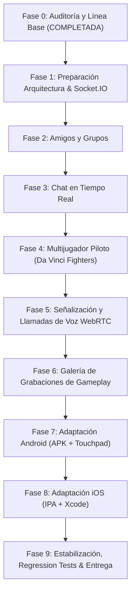

# C.C.I. SYSTEM — AUDITORÍA TÉCNICA Y LÍNEA BASE (FASE 0)
**Versión de referencia:** v2.1.0  
**Fecha de auditoría:** 5 de noviembre de 2026  
**Rama activa:** `feature/evolution-phase0`  
**Autora del proyecto:** Camila Carolina Ianni  

---

## 1. Resumen Ejecutivo y Estado del Repositorio

El repositorio base contiene una arquitectura híbrida de consola arcade de escritorio (Pygame-CE a 1280×720 a 60 FPS), persistencia local híbrida (JSON por usuario en `.cci-user-data/users/` + SQLite relacional WAL en `.cci-user-data/cci_system.sqlite3`), y un servidor web Flask (puerto 5050 / Render).

| Métrica / Componente | Estado Real Auditado |
|---|---|
| **Versión declarada** | `v2.1.0` en [version.json](../version.json) |
| **Batería de tests existente** | 16/16 tests pasados (9 en [test_phase2.py](../test_phase2.py), 7 en [test_phase3.py](../test_phase3.py)) |
| **Entorno de ejecución** | Python 3.14.5, Pygame-CE 2.5.8, OpenCV 5.0.0, NumPy 2.5.4, Pymunk 7.3.1, Flask 3.1.3 |
| **Catálogo total** | 19 títulos declarados en [catalog_data.py](../catalog_data.py) |
| **Juegos internos (in-process)** | **9 títulos** (integrados en `states.py` dentro de la misma ventana Pygame) |
| **Juegos externos (subprocesos)** | **10 títulos** (ejecutados mediante `subprocess.run([sys.executable, ...])`) |

---

## 2. Inventario y Auditoría Arquitectónica del Catálogo (19 Juegos)

La auditoría del código real en [states.py](../states.py) y [catalog_data.py](../catalog_data.py) revela una bifurcación crítica que el README no explicitaba:

### 2.1 Juegos Internos (Ejecución dentro del bucle de Pygame)
Estos títulos comparten la superficie `screen`, no abren ventanas secundarias y su estado de ejecución puede ser interceptado y sincronizado:
1. **`davinci` (Da Vinci Fighters)**: Lucha 2D 1v1. Soporta 1P y 2P simultáneo local.
2. **`metalslug` (Metal Slug)**: Acción run & gun 2D. Escala Neo-Geo (320×224 a 1280×720).
3. **`mario` (Super Mario Bros)**: Plataformas 1P.
4. **`zelda` (The Legend of Zelda)**: Acción/Aventura 1P.
5. **`pacman` (Pac-Man)**: Laberinto arcade. 1P o 2P por turnos alternados.
6. **`space_invaders` (Space Invaders)**: Shooter fijo. 1P o 2P por turnos alternados.
7. **`asteroids` (Asteroids)**: Vectorial espacial 1P.
8. **`tetris` (Tetris)**: Puzzle 1P.
9. **`doom` (DOOM)**: Raycaster pseudo-3D 1P.

### 2.2 Juegos Externos (Ejecución en subproceso independiente)
Ejecutados como carpetas independientes con sus propios scripts de entrada:
`flappy`, `dino`, `ghostbusters`, `cyberpunk`, `pokemon`, `megaman`, `castlevania`, `bubblebobble`, `plantsvszombies`, `donkeykong`.

> [!WARNING] **Impacto Crítico para Móviles (Android / iOS)**
> Los subprocesos vía `subprocess.run([sys.executable, ...])` **no funcionan en Android ni en iOS**, ya que el sandbox de la aplicación no permite invocar un binario Python independiente. Para los módulos D y E, la consola móvil sólo podrá ejecutar de forma nativa los 9 juegos internos, a menos que los externos sean migrados a módulos importables in-process.

---

## 3. Selección y Evaluación del Juego Piloto Multijugador

Para el **Módulo A (Fase 4: Multijugador Piloto)**, se auditaron los juegos con soporte para 2 jugadores:

| Juego Candidato | Modo 2P Actual | Desacople de Entrada / Estado | Veredicto para Piloto |
|---|---|---|---|
| **Da Vinci Fighters (`davinci`)** | **Simultáneo 1v1 PvP** | **Excelente**: `Player.handle_input()` consume `input_manager.get_player_state(player_id)`. Estados discretos (`idle`, `walk`, `punch`, `hit`, `ko`). | **CANDIDATO RECOMENDADO (PILOTO)** |
| **Space Invaders (`space_invaders`)** | Turnos alternados (hotseat clásico) | Lógica embebida en bucle de render. | No es versus simultáneo real. |
| **Pac-Man (`pacman`)** | Turnos alternados al morir | Bucle monolítico por cuadrícula. | No ofrece combate/competencia en tiempo real. |
| **Metal Slug (`metalslug`)** | Cooperativo simultáneo | Alta complejidad (cientos de proyectiles, físicas Neo-Geo, animaciones pesadas). | Demasiado complejo para piloto; ideal para fase posterior. |

### Justificación de Da Vinci Fighters como Piloto:
- Posee ya implementado el modo `MODE_PVP` con dos luchadores (`player1` y `player2`) en una arena fija de 2200px con cámara dinámica centrada.
- El sistema de entrada ya está abstraído por `player_id`: inyectar las entradas de red del jugador remoto al `player_id=2` requiere modificar mínimas líneas y no altera las físicas ni el renderizado.
- Validación de servidor autoritativo sencilla: posiciones `(x, y)`, vida (`health`), estado de animación y golpes recibidos.

---

## 4. Auditoría de Señalización, WebSockets y Llamadas WebRTC

### 4.1 Estado Actual
- El backend web actual ([web/app.py](../web/app.py)) es Flask REST síncrono.
- No existe servidor WebSocket activo ni dependencias de tiempo real instaladas en el `.venv`.

### 4.2 Arquitectura Recomendada para Red y Tiempo Real
1. **WebSocket / Presencia / Chat / Salas:**
   - Incorporar `Flask-SocketIO` con backend `simple-websocket` o `gevent-websocket` en Python.
   - Eventos bidireccionales: `room:create`, `room:join`, `room:ready`, `game:input`, `game:state_sync`, `chat:message`.
2. **Llamadas de Voz (WebRTC):**
   - **Señalización (Python):** Intercambio de ofertas/respuestas SDP y candidatos ICE sobre la misma conexión de Socket.IO / WebSocket.
   - **Transporte de audio:** Audio WebRTC P2P directo (o Mesh para grupos pequeños de 2-4 jugadores).
   - En clientes móviles y web: API WebRTC del sistema / navegador.
   - En cliente de escritorio Python: Prototipo con `aiortc` o puente de audio nativo de bajo retardo.

---

## 5. Auditoría de Base de Datos y Persistencia

### 5.1 Tablas Actuales en [cci_database.py](../cci_database.py)
- `accounts`: Cuentas y tokens.
- `games`: Catálogo de juegos.
- `profiles`: Perfiles de usuario.
- `game_stats`: Estadísticas de juego.
- `highscores`: Puntajes globales.
- `achievements_unlocked`: Logros desbloqueados.

### 5.2 Nuevas Entidades Requeridas (Migración Relacional)
Se diseñarán migraciones versionadas (sin borrar datos existentes):
1. `friendships` (`requester_id`, `addressee_id`, `status`, `created_at`, `updated_at`).
2. `groups` (`id`, `name`, `owner_id`, `avatar`, `created_at`, `visibility`).
3. `group_members` (`group_id`, `user_id`, `role`, `joined_at`, `status`).
4. `messages` (`id`, `group_id`, `sender_id`, `body`, `created_at`, `edited_at`, `deleted_at`).
5. `call_sessions` (`id`, `group_id`, `started_by`, `status`, `started_at`, `ended_at`).
6. `game_rooms` (`id`, `game_id`, `host_id`, `visibility`, `status`, `invite_code`, `created_at`).
7. `game_room_members` (`room_id`, `user_id`, `player_slot`, `ready_state`, `connection_state`).
8. `matches` (`id`, `room_id`, `game_id`, `started_at`, `ended_at`, `result_metadata`).
9. `gameplay_recordings` (`id`, `owner_id`, `game_id`, `local_path`, `duration`, `size_bytes`, `created_at`, `visibility`, `thumbnail_path`).

---

## 6. Auditoría de Grabaciones de Gameplay (Módulo C)

### 6.1 Estado Actual
- [screenshot_manager.py](../screenshot_manager.py) captura imágenes fijas en PNG a la carpeta `capturas/` mediante `pygame.image.save()`.
- No existe infraestructura de captura de video ni codificación temporal.

### 6.2 Factibilidad Técnica de Grabación en Python
- Verificada la existencia y funcionamiento de OpenCV (`cv2.VideoWriter`) en el entorno virtual (`.venv`).
- Codificación probada: contenedor MP4 (`fourcc: mp4v` / `avc1`).
- **Estrategia sin pérdida de FPS:**
  - Extraer buffer de la pantalla Pygame (`pygame.surfarray` o `pygame.image.tobytes`).
  - Enviar cuadros a una cola de subproceso `queue.Queue` en segundo plano.
  - El codificador de video corre en un hilo de trabajo dedicado (Worker Thread) a 30 FPS, evitando que el bucle de juego caiga de los 60 FPS estables.
  - Almacenamiento local en disco en carpeta `grabaciones/` con metadatos indexados en SQLite.

---

## 7. Factibilidad y Estrategia Móvil (Módulos D y E)

| Plataforma | Toolchain / Enfoque | Viabilidad Auditada | Limitaciones y Requisitos |
|---|---|---|---|
| **Android (APK)** | `python-for-android` (p4a) + `Buildozer` | **Alta** (para los 9 juegos internos de Pygame-CE) | 1. Requiere mando virtual táctil en pantalla. 2. Subprocesos externos deshabilitados. 3. Permisos de micrófono Android (`RECORD_AUDIO`). |
| **iOS (IPA)** | `kivy-ios` / `Briefcase` (BeeWare) | **Media-Alta** (con toolchain Xcode) | 1. Exige macOS + Xcode + cuenta de desarrollador Apple para firma y provisioning profiles. 2. Empaquetado estático SDL2. |

---

## 8. Plan de Trabajo por Fases y Próximos Pasos

- **Fase 1 inmediata**: Configurar servicios desacoplados en `backend/` y `network/`, agregar `requirements-server.txt`, crear migraciones de base de datos para amigos/grupos/salas y verificar no-regresión de la consola de PC existente.
