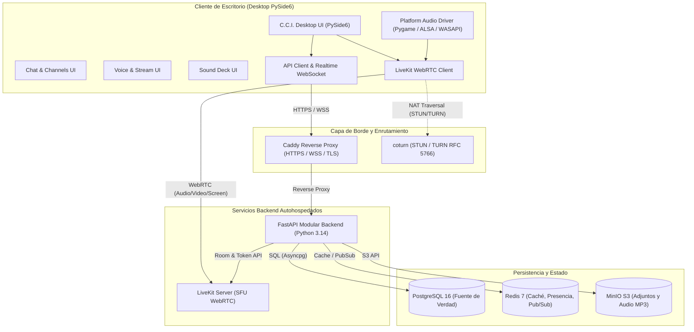
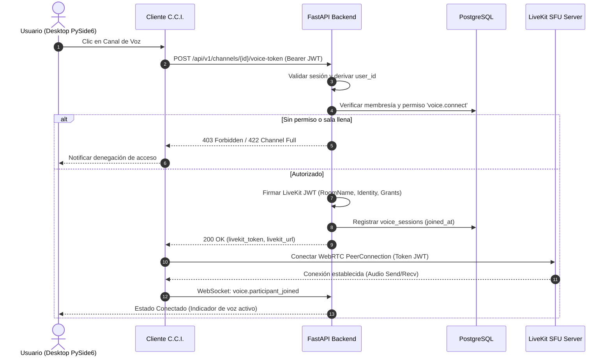
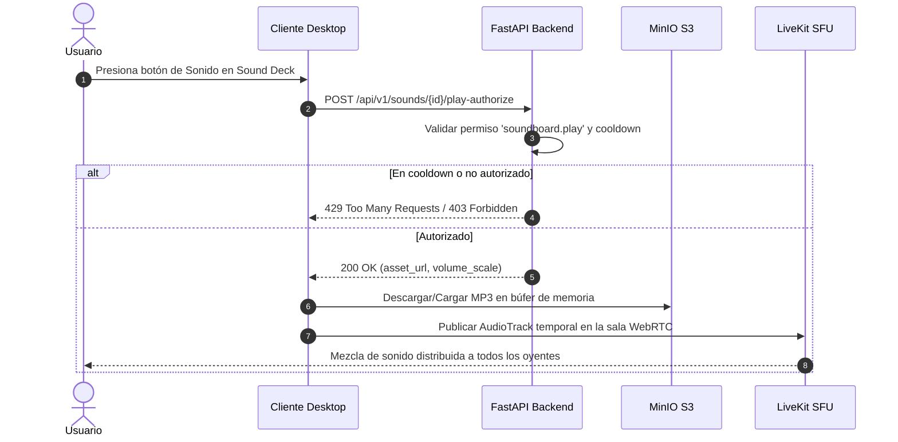

# C.C.I. SYSTEM — CCI COMMUNITIES
## Fase 0: Documento de Diseño y Arquitectura Técnica Integral

**Versión:** 1.0  
**Fecha:** 2026-11-06  
**Subsistema:** CCI Communities (Comunidades, Chat, Voz, Streaming, Sound Deck)  
**Estado:** DISEÑO APROBADO PARA REVISIÓN (Fase 0)  
**Rama:** `feature/communities-phase0-design`  

---

## 1. Resumen Ejecutivo y Alcance del Producto

El subsistema **CCI Communities** amplía **C.C.I. SYSTEM** para transformarlo en una plataforma social y de comunicación para comunidades gamer, directamente integrada al ecosistema de escritorio del launcher.

### Principios rectores de diseño:
1. **Infraestructura soberana y autohospedada**: Eliminación de dependencias de servicios en la nube propietarios (Discord, Twilio, Agora). Todo el stack se ejecuta en servidores propios mediante contenedores Docker.
2. **Desacoplamiento arquitectónico**: Separación estricta entre:
   - Capa de presentación visual (PySide6 con estilo retrofuturista de C.C.I.).
   - Núcleo de lógica de negocio y autorización (Python / FastAPI modular).
   - Transporte multimedia en tiempo real de baja latencia (LiveKit Server SFU + coturn).
   - Persistencia relacional (PostgreSQL 16) y estado efímero (Redis 7).
3. **Preservación absoluta del launcher y consola PC**: El motor de juegos de consola (1280x720, 60 FPS, 19 títulos en Pygame) permanece inalterado y soberano. La interfaz de comunidades convive como un panel/módulo de escritorio desacoplado.
4. **Seguridad fail-closed**: El backend C.C.I. es la única autoridad de identidad, pertenencia y roles. Los tokens de LiveKit se emiten con permisos mínimos y expiración corta (< 5 minutos).

---

## 2. Arquitectura del Sistema

### 2.1 Diagrama Lógico y Físico de Componentes



---

## 3. Flujos de Comunicación y Secuencias de Datos

### 3.1 Ingreso a Canal de Voz con Generación de Token LiveKit



### 3.2 Reproducción de Sonido Compartido (Sound Deck)



---

## 4. Modelo de Datos Relacional (PostgreSQL 16)

El esquema físico canónico está implementado en [`deploy/../documentacion/communities/schema_postgres.sql`](file:///Users/cami/Desktop/C.C.I%20SYSTEM/documentacion/communities/schema_postgres.sql).

### Entidades principales:
1. **`users`**: Cuentas con UUID, hash de contraseña argon2/bcrypt, estado de presencia (`online`, `idle`, `dnd`, `offline`, `invisible`) y avatar.
2. **`user_settings`**: Configuración de dispositivos de audio, volumen de salida, sensibilidad de entrada, push-to-talk (tecla rápida), y preferencias de privacidad.
3. **`communities`**: Servidor o comunidad gamer con `slug` único, visibilidad (`public` / `private`), `owner_id`, `max_members` y `max_streams_per_channel`. Borrado lógico con `deleted_at`.
4. **`roles`**: Jerarquía de roles por comunidad con posición numérica (`position`), color hexadecimal y bandera `is_admin`.
5. **`permissions` y `role_permissions`**: Matriz canónica de permisos con claves normalizadas (`community.manage`, `messages.send`, `voice.connect`, `soundboard.play`, etc.).
6. **`community_members` y `member_roles`**: Asociación N:M con estado del miembro (`active`, `muted`, `banned`) y apodo local.
7. **`channels` y `channel_categories`**: Canales de tipo `text`, `voice` y `stream`, organizados por categorías con posición y banderas de privacidad.
8. **`channel_permission_overrides`**: Sobrescrituras explícitas (`allow` / `deny`) por canal para roles o usuarios individuales.
9. **`messages` y `message_attachments`**: Historial de chat con soporte de respuestas (`reply_to_id`), mensajes fijados (`is_pinned`), borrado lógico y archivos adjuntos con hash SHA-256.
10. **`direct_conversations` y `direct_messages`**: Estructuras preparadas para mensajería privada 1 a 1 entre usuarios autorizados.
11. **`invitations`**: Códigos únicos con límite de usos (`max_uses`), contador y expiración temporal.
12. **`voice_sessions`**: Registro de conexiones en tiempo real a salas LiveKit para cálculo de concurrencia y auditoría.
13. **`sound_assets` y `sound_categories`**: Metadatos de pistas MP3 (máx 15s, máx 5 MB) con ámbitos `global`, `user` o `community`, escalado de volumen y cooldown anti-spam.
14. **`moderation_actions`**: Registro de auditoría para advertencias, silenciamientos, expulsiones y baneos con fecha de expiración.

---

## 5. Matriz de Permisos y Jerarquía de Resolución

### 5.1 Catálogo Canónico de Permisos

| Clave de Permiso | Categoría | Descripción Operativa |
| :--- | :--- | :--- |
| `community.manage` | Comunidad | Modificar nombre, icono, banner y ajustes globales |
| `community.view` | Comunidad | Ver canales públicos y listado de miembros |
| `community.invites.create` | Comunidad | Crear invitaciones con código |
| `community.roles.manage` | Roles | Crear y modificar roles con posición inferior al rol del actor |
| `community.members.kick` | Moderación | Expulsar miembros sin rol superior |
| `community.members.ban` | Moderación | Prohibir acceso y cancelar membresías |
| `channels.manage` | Canales | Crear, editar, ordenar y eliminar canales |
| `messages.read` | Chat | Leer historial y recibir eventos de mensajes |
| `messages.send` | Chat | Publicar mensajes en el canal |
| `messages.manage` | Chat | Borrar o fijar mensajes de otros miembros |
| `messages.attachments` | Chat | Subir adjuntos (imágenes, archivos) |
| `voice.connect` | Voz | Conectar a la sala de voz LiveKit |
| `voice.speak` | Voz | Transmitir pista de micrófono |
| `voice.stream` | Streaming | Publicar pista de pantalla/juego |
| `voice.mute_members` | Moderación Voz | Silenciar a otros participantes del canal |
| `soundboard.play` | Soundboard | Reproducir sonidos autorizados en la sala |
| `soundboard.manage` | Soundboard | Subir y borrar sonidos de la comunidad |

### 5.2 Algoritmo de Resolución de Permisos
1. Si el usuario es el **`owner_id`** de la comunidad: **Acceso total permitido (ALLOW)**.
2. Si el usuario posee un rol con **`is_admin = TRUE`**: **Acceso total permitido (ALLOW)**.
3. Se calcula el conjunto base de permisos acumulando todos los roles del miembro (`role_permissions`).
4. Si existe una sobrescritura de canal (`channel_permission_overrides`) para el **usuario**:
   - Si `deny = TRUE`: **DENY**.
   - Si `allow = TRUE`: **ALLOW**.
5. Si existe sobrescritura de canal para los **roles** del usuario:
   - Si algún rol tiene `deny = TRUE` y ninguno `allow = TRUE`: **DENY**.
   - Si algún rol tiene `allow = TRUE`: **ALLOW**.
6. Si no hay sobrescritura, rige el permiso base del rol. Por defecto: **DENY (Fail-Closed)**.

---

## 6. Especificación de Contratos de API REST (OpenAPI 3.1)

Todas las rutas privadas exigen cabecera `Authorization: Bearer <JWT>`.

| Método | Ruta | Parámetros / Cuerpo | Respuesta Exitosa | Códigos de Error |
| :--- | :--- | :--- | :--- | :--- |
| **POST** | `/api/v1/auth/register` | `{ username, email, password }` | `201 Created` `{ user, token }` | 400 (Duplicado), 422 (Validación) |
| **POST** | `/api/v1/auth/login` | `{ email_or_username, password }` | `200 OK` `{ user, token }` | 401 (Credenciales inválidas) |
| **GET** | `/api/v1/communities` | Query: `visibility=public` | `200 OK` `[ { community } ]` | 401 |
| **POST** | `/api/v1/communities` | `{ name, slug, description, visibility }` | `201 Created` `{ community }` | 400 (Slug en uso), 401 |
| **GET** | `/api/v1/communities/{id}` | Path: `id` | `200 OK` `{ community, channels, roles }` | 403 (No miembro), 404 |
| **PATCH** | `/api/v1/communities/{id}` | `{ name, description, icon_url }` | `200 OK` `{ community }` | 403 (Sin permiso `community.manage`) |
| **POST** | `/api/v1/communities/{id}/invitations` | `{ max_uses, expires_in_hours }` | `201 Created` `{ code, expires_at }` | 403, 404 |
| **POST** | `/api/v1/invitations/{code}/accept`| Path: `code` | `200 OK` `{ community_id, member }` | 404, 410 (Expirada) |
| **GET** | `/api/v1/communities/{id}/channels`| Path: `id` | `200 OK` `[ { channel } ]` | 403, 404 |
| **POST** | `/api/v1/communities/{id}/channels`| `{ name, type, category_id, topic }` | `201 Created` `{ channel }` | 403 (Sin permiso `channels.manage`) |
| **GET** | `/api/v1/channels/{id}/messages` | Query: `limit=50, before_id` | `200 OK` `[ { message } ]` | 403 (Sin permiso `messages.read`) |
| **POST** | `/api/v1/channels/{id}/messages` | `{ content, reply_to_id }` | `201 Created` `{ message }` | 403 (Sin permiso `messages.send`) |
| **POST** | `/api/v1/channels/{id}/voice-token` | Path: `id` | `200 OK` `{ token, url, room_name }`| 403 (Sin permiso `voice.connect`), 422 |
| **GET** | `/api/v1/sounds` | Query: `scope=community&scope_id={id}`| `200 OK` `[ { sound_asset } ]` | 401, 403 |
| **POST** | `/api/v1/sounds` | Multipart: `file, title, scope_type, scope_id` | `201 Created` `{ sound_asset }` | 400 (Formato no MP3), 413 (> 5 MB) |
| **POST** | `/api/v1/sounds/{id}/play-authorize`| `{ channel_id }` | `200 OK` `{ authorized: true, playback_token }` | 403, 429 (Cooldown activo) |

---

## 7. Especificación de Eventos en Tiempo Real (WebSocket / WSS)

Los eventos se transmiten sobre canal WebSocket autenticado (`/ws/communities`).  
Formato estándar del payload:
```json
{
  "event": "nombre_evento",
  "version": 1,
  "timestamp": "2026-11-06T12:00:00Z",
  "data": { ... }
}
```

### Catálogo de Eventos Bidireccionales:

1. **`message.created`** (Servidor → Clientes):
   Emite un nuevo mensaje persistido a todos los miembros con `messages.read` en el canal.
   ```json
   { "id": "uuid", "channel_id": "uuid", "author": { "id": "uuid", "username": "Juan" }, "content": "Hola equipo", "created_at": "..." }
   ```
2. **`presence.updated`** (Servidor → Clientes):
   Actualiza estado (`online`, `idle`, `dnd`, `offline`) y actividad actual de un usuario.
3. **`typing.started`** (Cliente → Servidor → Clientes):
   Indica que un usuario está escribiendo (cooldown automático de 5s).
4. **`voice.participant_joined` / `voice.participant_left`** (Servidor → Clientes):
   Sincroniza la lista visual de participantes conectados a la sala de voz LiveKit.
5. **`stream.started` / `stream.ended`** (Servidor → Clientes):
   Notifica inicio/fin de transmisión de pantalla o juego en un canal.
6. **`sound.play_broadcast`** (Servidor → Clientes de la sala de voz):
   Notifica a la sala que un usuario activó un sonido, incluyendo metadata y emisor.
7. **`notification.created`** (Servidor → Cliente particular):
   Menciones (`@usuario`), respuestas a mensajes o alertas de moderación.

---

## 8. Registros de Decisiones de Arquitectura (ADRs)

### ADR-001: Adopción de FastAPI como Monolito Modular Asíncrono
- **Contexto**: El backend actual C.C.I. utiliza Flask. Para Communities se requiere alta concurrencia de WebSockets, tipado estricto con Pydantic y soporte nativo asíncrono para bases de datos (asyncpg).
- **Decisión**: Implementar el backend de Communities en FastAPI con arquitectura monolítica modular (`app/communities`, `app/chat`, `app/voice`, `app/soundboard`).
- **Consecuencias**: Excelente rendimiento asíncrono, OpenAPI autogenerado y código desacoplado.

### ADR-002: PySide6 para la Interfaz de Comunidades Desktop
- **Contexto**: La consola de juegos corre en Pygame a 60 FPS (1280x720). Incrustar un cliente social completo tipo Discord (listas dinámicas, scroll, campos de texto enriquecido, renderizado de avatares) dentro de un loop de Pygame generaría sobrecarga y complejidad inmanejable.
- **Decisión**: Utilizar PySide6 (Qt para Python) para la aplicación de escritorio y paneles de comunidad, manteniendo interoperabilidad mediante sockets locales y procesos compartidos con el launcher de Pygame.
- **Consecuencias**: Controles nativos fluidos, aceleración gráfica por hardware y modularidad completa.

### ADR-003: LiveKit Server (SFU) Autohospedado sobre WebRTC Mesh
- **Contexto**: Las llamadas grupales WebRTC en topología Mesh saturan la CPU y ancho de banda del cliente a partir de 3-4 participantes ($N \times (N-1)$ conexiones).
- **Decisión**: Desplegar LiveKit Server como SFU (Selective Forwarding Unit) autohospedado en contenedor Docker.
- **Consecuencias**: Cada cliente envía 1 pista y recibe las pistas suscritas. Escala hasta cientos de usuarios por sala con mínimo uso de CPU cliente. Requiere servidor con puertos UDP públicos y coturn para STUN/TURN.

### ADR-004: PostgreSQL 16 y Redis 7 para Persistencia y Estado Efímero
- **Contexto**: SQLite local no permite concurrencia multi-cliente en red; Redis es indispensable para presencia de usuarios, rate-limiting y fan-out de WebSockets entre workers.
- **Decisión**: PostgreSQL 16 es la fuente de verdad persistente (relaciones N:M, integridad referencial y borrado lógico). Redis 7 almacena sesiones activas, presencia y colas Pub/Sub.
- **Consecuencias**: Infraestructura estándar, robusta y escalable.

### ADR-005: MinIO S3 para Almacenamiento de Adjuntos y Sound Deck
- **Contexto**: Los avatares, capturas y pistas MP3 de la soundboard no deben residir en la base de datos relacional.
- **Decisión**: Contenedor MinIO compatible con API Amazon S3 para almacenamiento de blobs con URLs prefirmadas de subida y lectura.
- **Consecuencias**: Gestión eficiente de archivos estáticos y desacoplamiento del almacenamiento.

### ADR-006: Canal de Audio Compartido en LiveKit para el Sound Deck
- **Contexto**: La especificación exige que los sonidos de la soundboard se transmitan a todos los oyentes de la llamada de voz.
- **Decisión**: El cliente desktop abre una pista de audio secundaria (`MicrophoneAudioTrack` o `CustomAudioTrack`) en la sesión LiveKit activa y reproduce el búfer PCM decodificado del MP3.
- **Consecuencias**: No requiere puentes de red adicionales; el sonido viaja sincronizado por el mismo canal WebRTC de la sala.

---

## 9. Despliegue de Infraestructura Autohospedada (`docker-compose`)

Configurado en [`deploy/docker-compose.communities.yml`](file:///Users/cami/Desktop/C.C.I%20SYSTEM/deploy/docker-compose.communities.yml):

- **`postgres`**: PostgreSQL 16 Alpine con inicialización automática del esquema [`schema_postgres.sql`](file:///Users/cami/Desktop/C.C.I%20SYSTEM/documentacion/communities/schema_postgres.sql).
- **`redis`**: Redis 7 Alpine con contraseña y persistencia AOF habilitada.
- **`minio`**: Servidor S3 con consola de administración web en puerto 9001.
- **`coturn`**: Servidor STUN/TURN RFC 5766 con credenciales seguras de larga duración.
- **`livekit`**: SFU de distribución multimedia con puertos WebRTC 50000-50100/UDP.
- **`api`**: Servidor FastAPI (Uvicorn workers) conectado a Postgres, Redis y LiveKit.
- **`caddy`**: Proxy inverso de entrada con certificados TLS automáticos.

---

## 10. Convivencia con el Código Existente de C.C.I. SYSTEM

Para cumplir rigurosamente las directivas de auditoría técnica:
1. **Consola Desktop PC Soberana**: Los 19 juegos nativos y el menú clásico Pygame (1280x720, 60 FPS) se mantienen íntegros y ejecutables de forma independiente.
2. **Preservación del módulo de voz existente**: [`mobile/voice_client.py`](file:///Users/cami/Desktop/C.C.I%20SYSTEM/mobile/voice_client.py) permanece intacto para partidas P2P locales / móviles. La integración de LiveKit se realiza en un módulo separado (`communities/media_livekit.py`) sin modificar la lógica previa.
3. **Control de versiones**: Todo el trabajo se estructura en commits pequeños en la rama `feature/communities-phase0-design`, manteniendo la suite previa de 105 pruebas unitarias siempre en estado 100% aprobado.

---

## 11. Criterios de Aceptación para Concluir Fase 0

- [x] Modelo ER de PostgreSQL normalizado con DDL SQL ejecutable ([`schema_postgres.sql`](file:///Users/cami/Desktop/C.C.I%20SYSTEM/documentacion/communities/schema_postgres.sql)).
- [x] Matriz jerárquica de permisos y algoritmo de resolución formalizado.
- [x] Contratos OpenAPI 3.1 y catálogo de eventos WebSocket detallados.
- [x] Registros de decisiones de arquitectura (ADR-001 a ADR-006).
- [x] Manifiesto Docker Compose completo y reproducible ([`docker-compose.communities.yml`](file:///Users/cami/Desktop/C.C.I%20SYSTEM/deploy/docker-compose.communities.yml)).
- [x] Registro explícito de decisiones de producto provisionales.
- [x] Cero regresiones en la suite de 105 pruebas de la consola C.C.I.
