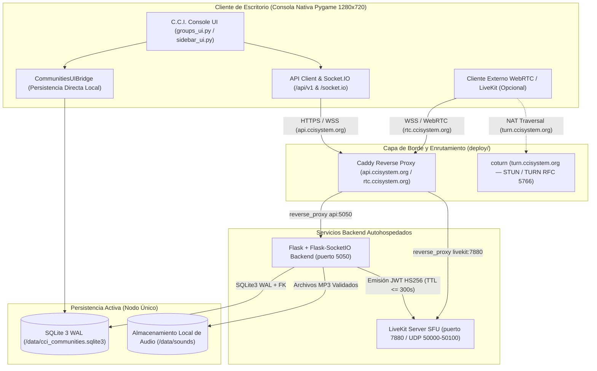
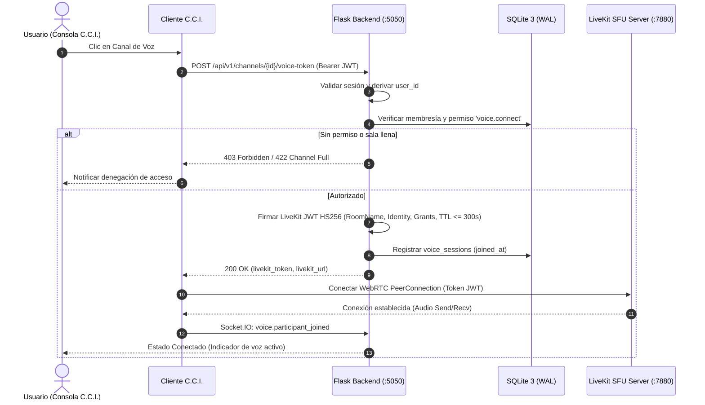
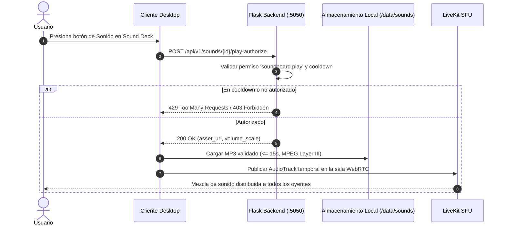

# C.C.I. SYSTEM — CCI COMMUNITIES
## Fase 0: Documento de Diseño y Arquitectura Técnica Integral

**Versión:** 1.0  
**Fecha:** 2026-11-06  
**Subsistema:** CCI Communities (Comunidades, Chat, Voz, Streaming, Sound Deck)  
**Estado:** DISEÑO APROBADO PARA REVISIÓN (Fase 0)  
**Rama:** `feature/communities-phase0-design`  

---

## 1. Resumen Ejecutivo y Alcance del Producto

El subsistema **CCI Communities** amplía **C.C.I. SYSTEM** para transformarlo en una plataforma social y de comunicación para comunidades gamer, directamente integrada al ecosistema de escritorio del launcher.

### Principios rectores de diseño:
1. **Infraestructura soberana y autohospedada**: Eliminación de dependencias de servicios en la nube propietarios (Discord, Twilio, Agora). Todo el stack se ejecuta en servidores propios mediante contenedores Docker.
2. **Desacoplamiento arquitectónico y unificación con C.C.I. SYSTEM**: Separación estricta entre:
   - Capa de presentación visual integrada en la consola nativa Pygame 1280x720 (`groups_ui.py`, `sidebar_ui.py`) con estética pixel-art retrofuturista de C.C.I.
   - Núcleo de lógica de negocio y autorización unificado en Python (`Flask` + `Flask-SocketIO` en `backend/server.py` + `backend/communities/`).
   - Transporte multimedia en tiempo real de baja latencia (LiveKit Server SFU + `coturn` para STUN/TURN externo, con emisión local autoritativa de tokens JWT HS256).
   - Persistencia relacional transaccional en **SQLite 3 con `WAL`** (`PRAGMA journal_mode=WAL`, `PRAGMA foreign_keys=ON`, `PRAGMA busy_timeout=10000`) como **único motor activo, documentado y soportado en esta entrega** (`.cci-user-data/cci_communities.sqlite3` en escritorio / `/data/cci_communities.sqlite3` en Docker), especificado en [`documentacion/communities/schema_sqlite.sql`](file:///Users/cami/Desktop/C.C.I%20SYSTEM/documentacion/communities/schema_sqlite.sql).
3. **Preservación absoluta del launcher y consola PC**: El motor de juegos de consola (1280x720, 60 FPS, 19 títulos en Pygame) permanece inalterado y soberano. La interfaz de comunidades convive como estados nativos desacoplados (`GROUPS`, `COMMUNITY`).
4. **Seguridad fail-closed**: El backend C.C.I. es la única autoridad de identidad, pertenencia y roles. Los tokens de LiveKit se emiten con permisos mínimos y expiración corta (`<= 300` segundos / `< 5` minutos, por defecto `240` segundos).

---

## 2. Arquitectura del Sistema

### 2.1 Diagrama Lógico y Físico de Componentes (Arquitectura Activa Fase 0.2)



---

## 3. Flujos de Comunicación y Secuencias de Datos

### 3.1 Ingreso a Canal de Voz con Generación de Token LiveKit



### 3.2 Reproducción de Sonido Compartido (Sound Deck)



---

## 4. Modelo de Datos Relacional (SQLite 3 WAL Canónico)

El esquema relacional activo se inicializa automáticamente en **SQLite 3 (`WAL`)** dentro de [`backend/communities/repository.py`](file:///Users/cami/Desktop/C.C.I%20SYSTEM/backend/communities/repository.py) y su DDL físico canónico está documentado en [`documentacion/communities/schema_sqlite.sql`](file:///Users/cami/Desktop/C.C.I%20SYSTEM/documentacion/communities/schema_sqlite.sql).

### Entidades principales:
1. **`users`**: Cuentas con UUID, hash de contraseña argon2/bcrypt, estado de presencia (`online`, `idle`, `dnd`, `offline`, `invisible`) y avatar.
2. **`user_settings`**: Configuración de dispositivos de audio, volumen de salida, sensibilidad de entrada, push-to-talk (tecla rápida), y preferencias de privacidad.
3. **`communities`**: Servidor o comunidad gamer con `slug` único, visibilidad (`public` / `private`), `owner_id`, `max_members` y `max_streams_per_channel`. Borrado lógico con `deleted_at`.
4. **`roles`**: Jerarquía de roles por comunidad con posición numérica (`position`), color hexadecimal y bandera `is_admin`.
5. **`permissions` y `role_permissions`**: Matriz canónica de permisos con claves normalizadas (`community.manage`, `messages.send`, `voice.connect`, `soundboard.play`, etc.).
6. **`community_members` y `member_roles`**: Asociación N:M con estado del miembro (`active`, `muted`, `banned`) y apodo local.
7. **`channels` y `channel_categories`**: Canales de tipo `text`, `voice` y `stream`, organizados por categorías con posición y banderas de privacidad.
8. **`channel_permission_overrides`**: Sobrescrituras explícitas (`allow` / `deny`) por canal para roles o usuarios individuales.
9. **`messages` y `message_attachments`**: Historial de chat con soporte de respuestas (`reply_to_id`), mensajes fijados (`is_pinned`), borrado lógico y archivos adjuntos con hash SHA-256.
10. **`direct_conversations` y `direct_messages`**: Estructuras preparadas para mensajería privada 1 a 1 entre usuarios autorizados.
11. **`invitations`**: Códigos únicos con límite de usos (`max_uses`), contador y expiración temporal.
12. **`voice_sessions`**: Registro de conexiones en tiempo real a salas LiveKit para cálculo de concurrencia y auditoría.
13. **`sound_assets` y `sound_categories`**: Metadatos de pistas MP3 (máx 15s, máx 5 MB) con ámbitos `global`, `user` o `community`, escalado de volumen y cooldown anti-spam.
14. **`moderation_actions`**: Registro de auditoría para advertencias, silenciamientos, expulsiones y baneos con fecha de expiración.

---

## 5. Matriz de Permisos y Jerarquía de Resolución

### 5.1 Catálogo Canónico de Permisos

| Clave de Permiso | Categoría | Descripción Operativa |
| :--- | :--- | :--- |
| `community.manage` | Comunidad | Modificar nombre, icono, banner y ajustes globales |
| `community.view` | Comunidad | Ver canales públicos y listado de miembros |
| `community.invites.create` | Comunidad | Crear invitaciones con código |
| `community.roles.manage` | Roles | Crear y modificar roles con posición inferior al rol del actor |
| `community.members.kick` | Moderación | Expulsar miembros sin rol superior |
| `community.members.ban` | Moderación | Prohibir acceso y cancelar membresías |
| `channels.manage` | Canales | Crear, editar, ordenar y eliminar canales |
| `messages.read` | Chat | Leer historial y recibir eventos de mensajes |
| `messages.send` | Chat | Publicar mensajes en el canal |
| `messages.manage` | Chat | Borrar o fijar mensajes de otros miembros |
| `messages.attachments` | Chat | Subir adjuntos (imágenes, archivos) |
| `voice.connect` | Voz | Conectar a la sala de voz LiveKit |
| `voice.speak` | Voz | Transmitir pista de micrófono |
| `voice.stream` | Streaming | Publicar pista de pantalla/juego |
| `voice.mute_members` | Moderación Voz | Silenciar a otros participantes del canal |
| `soundboard.play` | Soundboard | Reproducir sonidos autorizados en la sala |
| `soundboard.manage` | Soundboard | Subir y borrar sonidos de la comunidad |

### 5.2 Algoritmo de Resolución de Permisos
1. Si el usuario es el **`owner_id`** de la comunidad: **Acceso total permitido (ALLOW)**.
2. Si el usuario posee un rol con **`is_admin = TRUE`**: **Acceso total permitido (ALLOW)**.
3. Se calcula el conjunto base de permisos acumulando todos los roles del miembro (`role_permissions`).
4. Si existe una sobrescritura de canal (`channel_permission_overrides`) para el **usuario**:
   - Si `deny = TRUE`: **DENY**.
   - Si `allow = TRUE`: **ALLOW**.
5. Si existe sobrescritura de canal para los **roles** del usuario:
   - Si algún rol tiene `deny = TRUE` y ninguno `allow = TRUE`: **DENY**.
   - Si algún rol tiene `allow = TRUE`: **ALLOW**.
6. Si no hay sobrescritura, rige el permiso base del rol. Por defecto: **DENY (Fail-Closed)**.

---

## 6. Especificación de Contratos de API REST (OpenAPI 3.1)

Todas las rutas privadas exigen cabecera `Authorization: Bearer <JWT>`.

| Método | Ruta | Parámetros / Cuerpo | Respuesta Exitosa | Códigos de Error |
| :--- | :--- | :--- | :--- | :--- |
| **POST** | `/api/v1/auth/register` | `{ username, email, password }` | `201 Created` `{ user, token }` | 400 (Duplicado), 422 (Validación) |
| **POST** | `/api/v1/auth/login` | `{ email_or_username, password }` | `200 OK` `{ user, token }` | 401 (Credenciales inválidas) |
| **GET** | `/api/v1/communities` | Query: `visibility=public` | `200 OK` `[ { community } ]` | 401 |
| **POST** | `/api/v1/communities` | `{ name, slug, description, visibility }` | `201 Created` `{ community }` | 400 (Slug en uso), 401 |
| **GET** | `/api/v1/communities/{id}` | Path: `id` | `200 OK` `{ community, channels, roles }` | 403 (No miembro), 404 |
| **PATCH** | `/api/v1/communities/{id}` | `{ name, description, icon_url }` | `200 OK` `{ community }` | 403 (Sin permiso `community.manage`) |
| **POST** | `/api/v1/communities/{id}/invitations` | `{ max_uses, expires_in_hours }` | `201 Created` `{ code, expires_at }` | 403, 404 |
| **POST** | `/api/v1/invitations/{code}/accept`| Path: `code` | `200 OK` `{ community_id, member }` | 404, 410 (Expirada) |
| **GET** | `/api/v1/communities/{id}/channels`| Path: `id` | `200 OK` `[ { channel } ]` | 403, 404 |
| **POST** | `/api/v1/communities/{id}/channels`| `{ name, type, category_id, topic }` | `201 Created` `{ channel }` | 403 (Sin permiso `channels.manage`) |
| **GET** | `/api/v1/channels/{id}/messages` | Query: `limit=50, before_id` | `200 OK` `[ { message } ]` | 403 (Sin permiso `messages.read`) |
| **POST** | `/api/v1/channels/{id}/messages` | `{ content, reply_to_id }` | `201 Created` `{ message }` | 403 (Sin permiso `messages.send`) |
| **POST** | `/api/v1/channels/{id}/voice-token` | Path: `id` | `200 OK` `{ token, url, room_name }`| 403 (Sin permiso `voice.connect`), 422 |
| **GET** | `/api/v1/sounds` | Query: `scope=community&scope_id={id}`| `200 OK` `[ { sound_asset } ]` | 401, 403 |
| **POST** | `/api/v1/sounds` | Multipart: `file, title, scope_type, scope_id` | `201 Created` `{ sound_asset }` | 400 (Formato no MP3), 413 (> 5 MB) |
| **POST** | `/api/v1/sounds/{id}/play-authorize`| `{ channel_id }` | `200 OK` `{ authorized: true, playback_token }` | 403, 429 (Cooldown activo) |

---

## 7. Especificación de Eventos en Tiempo Real (WebSocket / WSS)

Los eventos se transmiten sobre canal WebSocket autenticado (`/ws/communities`).  
Formato estándar del payload:
```json
{
  "event": "nombre_evento",
  "version": 1,
  "timestamp": "2026-11-06T12:00:00Z",
  "data": { ... }
}
```

### Catálogo de Eventos Bidireccionales:

1. **`message.created`** (Servidor → Clientes):
   Emite un nuevo mensaje persistido a todos los miembros con `messages.read` en el canal.
   ```json
   { "id": "uuid", "channel_id": "uuid", "author": { "id": "uuid", "username": "Juan" }, "content": "Hola equipo", "created_at": "..." }
   ```
2. **`presence.updated`** (Servidor → Clientes):
   Actualiza estado (`online`, `idle`, `dnd`, `offline`) y actividad actual de un usuario.
3. **`typing.started`** (Cliente → Servidor → Clientes):
   Indica que un usuario está escribiendo (cooldown automático de 5s).
4. **`voice.participant_joined` / `voice.participant_left`** (Servidor → Clientes):
   Sincroniza la lista visual de participantes conectados a la sala de voz LiveKit.
5. **`stream.started` / `stream.ended`** (Servidor → Clientes):
   Notifica inicio/fin de transmisión de pantalla o juego en un canal.
6. **`sound.play_broadcast`** (Servidor → Clientes de la sala de voz):
   Notifica a la sala que un usuario activó un sonido, incluyendo metadata y emisor.
7. **`notification.created`** (Servidor → Cliente particular):
   Menciones (`@usuario`), respuestas a mensajes o alertas de moderación.

---

## 8. Registros de Decisiones de Arquitectura (ADRs) y Estado de Implementación Real

### Matriz de Componentes: Implementado (Fase 0.2) vs. Alcance Parcial / Fase Futura
| Componente | Estado en Código (`feature/communities-phase0-design`) | Alcance y Notas Operativas |
| :--- | :--- | :--- |
| **Backend API & Realtime** | **Implementado** (`Flask` + `Flask-SocketIO` en `backend/server.py` y `backend/communities/routes.py`) | Unificado en el mismo servidor del sistema C.C.I. (`puerto 5050` en `Dockerfile.backend`, `docker-compose.communities.yml` y `Caddyfile`). |
| **Persistencia Relacional** | **Implementado (Único motor activo)** (`SQLite 3 WAL` en `backend/communities/repository.py` y `schema_sqlite.sql`) | Persistencia en disco (`.cci-user-data/cci_communities.sqlite3` / `/data/cci_communities.sqlite3`), `PRAGMA foreign_keys=ON`, `WAL`, `busy_timeout=10000` y `RLock` multihilo. |
| **Interfaz Gráfica (UI)** | **Implementado** (`Pygame` nativo en `groups_ui.py` y `sidebar_ui.py`) | Integrada directamente en el bucle de estados de `main.py` (1280x720, 60 FPS) conectada a `CommunitiesService` con persistencia real en SQLite (`CommunitiesUIBridge`). |
| **Tokens y Señalización de Voz (LiveKit)** | **Plano de Control Implementado** (`backend/communities/livekit_token.py`) / **Transporte SFU Externo Fuera del Alcance** | El backend emite y valida tokens JWT HS256 con TTL `<= 300s` (240s por defecto) y señalización Socket.IO. El transporte de medios WebRTC sobre red WAN/NAT/SFU externo queda **formalmente fuera del alcance** del runtime Python de esta fase. |
| **Streaming y Captura (`stream_adapter.py`)** | **Alcance Parcial (Detección + Preview Local + Señalización)** (`backend/communities/stream_adapter.py`) | Separa explícitamente: (1) detección real de fuentes del SO (`ps` / `pygame.display`), (2) captura de preview local RGB24 de la superficie Pygame activa, y (3) publicación multimedia WebRTC entre equipos remotos marcada **formalmente fuera del alcance** de esta fase (`external_livekit_sfu_client_required`). |
| **Sound Deck (Validador MP3)** | **Implementado** (`backend/communities/sound_validator.py`) | Decodifica cabeceras de tramas MPEG reales (MPEG 1/2/2.5 Layer III y cabeceras VBR Xing/Info) para calcular duración real (`<= 15.0s`), bitrate, sample rate y canales sin confiar en `declared_duration`. |
| **Métricas y Salud** | **Implementado** (`backend/communities/metrics.py`) | Contadores e histogramas por proceso (`scope: process_local`, no persistentes entre reinicios) expuestos en formato Prometheus y JSON junto con sonda real de base de datos en `/api/v1/communities/health`. |

### ADR-001 (Actualizado): Unificación en Flask + Flask-SocketIO como Monolito Modular (Puerto 5050)
- **Contexto**: El diseño preliminar evaluó FastAPI, pero el núcleo productivo de C.C.I. SYSTEM ya opera sobre `Flask` + `Flask-SocketIO` (`backend/server.py`, `requirements-server.txt`).
- **Decisión**: Integrar `backend/communities` como un Blueprint modular dentro del servidor `Flask` + `Flask-SocketIO` existente escuchando en el puerto canónico `5050`, enrutado por Caddy (`reverse_proxy api:5050`) tanto para HTTP (`/api/*`) como para WebSocket (`/socket.io/*`, `/ws/*`).
- **Consecuencias**: Cero duplicación de servidores, autenticación JWT unificada (`backend/auth.py`) y despliegue único en `deploy/Dockerfile.backend`.

### ADR-002 (Actualizado): Interfaz Nativa en Pygame Integrada al Launcher
- **Contexto**: Para mantener una experiencia visual 100% homogénea en la consola (1280x720, pixel-art C.C.I.) sin abrir ventanas externas de Qt/PySide6.
- **Decisión**: Implementar `GroupsHubState` y `CommunityViewState` en `groups_ui.py` dentro del motor de estados de `main.py`, respaldados por `CommunitiesService` y SQLite.
- **Consecuencias**: Transiciones instantáneas desde la barra lateral (`sidebar_ui.py`) y persistencia real de mensajes, grupos e invitaciones.

### ADR-003: Plano de Control LiveKit JWT y Delimitación de Transporte WebRTC Externo
- **Contexto**: Las llamadas grupales WebRTC en topología Mesh saturan la CPU del cliente a partir de 4 participantes.
- **Decisión**: Implementar en esta fase el plano de control completo en Python (`backend/communities/livekit_token.py`, `routes.py`, `events.py`): emisión/verificación de tokens JWT HS256 (`TTL <= 300s`, `240s` por defecto), gestión de sesiones en SQLite y señalización Socket.IO, junto con los manifiestos de infraestructura para `livekit` (`rtc.ccisystem.org`) y `coturn` (`turn.ccisystem.org` en `3478/UDP+TCP` con `use-auth-secret` y `no-tls`).
- **Delimitación Formal de Alcance**: El transporte continuo de medios WebRTC sobre un servidor LiveKit SFU externo y el relay TURN/TLS (`5349`) entre redes WAN quedan **formalmente fuera del alcance** del runtime Python en esta fase.

### ADR-004 (Actualizado Fase 0.2): SQLite 3 (WAL) como Único Motor Activo, Documentado y Soportado
- **Contexto**: Para eliminar cualquier divergencia entre documentación y runtime, se unifica el motor relacional en toda la arquitectura y documentación del proyecto.
- **Decisión**: **SQLite 3 en modo `WAL`** (`PRAGMA journal_mode=WAL`, `PRAGMA foreign_keys=ON`, `PRAGMA busy_timeout=10000`, `PRAGMA synchronous=NORMAL`) es el **único motor de base de datos activo y soportado** en esta entrega ([`backend/communities/repository.py`](file:///Users/cami/Desktop/C.C.I%20SYSTEM/backend/communities/repository.py) y [`documentacion/communities/schema_sqlite.sql`](file:///Users/cami/Desktop/C.C.I%20SYSTEM/documentacion/communities/schema_sqlite.sql)).
- **Límites operativos, concurrencia y procedimiento de backup de SQLite 3**:
  - **Modelo de concurrencia**: Lecturas concurrentes no bloqueantes gracias a `WAL` y escrituras serializadas de forma segura entre hilos mediante `threading.RLock()` de instancia + `PRAGMA busy_timeout=10000` (10 s). Diseñado para despliegues de nodo único (hasta ~100–250 usuarios concurrentes activos y decenas de escrituras por segundo).
  - **Límite arquitectónico**: No soporta múltiples réplicas de escritura distribuidas sobre sistemas de archivos de red (NFS/SMB); el volumen `cci_app_data:/data` debe residir en disco local POSIX del host.
  - **Procedimiento de Backup en Caliente (Online Backup)**: Ejecutar `sqlite3 /data/cci_communities.sqlite3 ".backup '/data/backups/cci_communities_$(date +%Y%m%d_%H%M%S).sqlite3'"` (o usar la API `sqlite3.Connection.backup()`), lo cual genera una copia consistente sin detener el servicio `api`.

---

## 9. Despliegue de Infraestructura Autohospedada (`docker-compose`)

Configurado en [`deploy/docker-compose.communities.yml`](file:///Users/cami/Desktop/C.C.I%20SYSTEM/deploy/docker-compose.communities.yml), [`deploy/Dockerfile.backend`](file:///Users/cami/Desktop/C.C.I%20SYSTEM/deploy/Dockerfile.backend) y [`deploy/Caddyfile`](file:///Users/cami/Desktop/C.C.I%20SYSTEM/deploy/Caddyfile):

- **Dominios canónicos unificados**:
  - `api.ccisystem.org`: API REST (`/api/*`) y WebSockets (`/socket.io/*`, `/ws/*`) -> `api:5050`.
  - `rtc.ccisystem.org`: Señalización WebRTC LiveKit -> `livekit:7880`.
  - `turn.ccisystem.org`: Relay STUN/TURN RFC 5766 -> `coturn` (`3478/TCP+UDP`, `49152-49200/UDP`, con `no-tls`/`no-dtls` explícito por defecto).
- **Servicios activos en `docker-compose.communities.yml`**:
  - **`api`**: Contenedor Python 3.14 non-root (`cciuser`) ejecutando `backend.server` en puerto `5050` con SQLite 3 WAL en `cci_app_data:/data/cci_communities.sqlite3` y `HEALTHCHECK` activo.
  - **`livekit`**: SFU de distribución multimedia con puertos `7880/TCP`, `7881/TCP` y `50000-50100/UDP`, y claves inyectadas desde variables de entorno.
  - **`coturn`**: Servidor STUN/TURN RFC 5766 en `3478/UDP+TCP` con `use-auth-secret` inyectado desde `${TURN_SECRET}` (validado en producción con longitud mínima de 32 caracteres) y `no-tls`/`no-dtls` hasta aprovisionar certificados X.509 dedicados.
  - **`caddy`**: Proxy inverso de entrada con certificados TLS automáticos y cabeceras `Connection`/`Upgrade` para WebSockets hacia `api:5050` y `livekit:7880`.

---

## 10. Convivencia con el Código Existente de C.C.I. SYSTEM

Para cumplir rigurosamente las directivas de auditoría técnica:
1. **Consola Desktop PC Soberana**: Los 19 juegos nativos y el menú clásico Pygame (1280x720, 60 FPS) se mantienen íntegros y ejecutables de forma independiente.
2. **Preservación del módulo de voz existente**: [`mobile/voice_client.py`](file:///Users/cami/Desktop/C.C.I%20SYSTEM/mobile/voice_client.py) permanece intacto para partidas P2P locales / móviles sobre sockets UDP RTP (`RFC 3550`).
3. **Control de versiones**: Todo el trabajo se estructura en la rama `feature/communities-phase0-design` (incluyendo la base evolutiva Fases 1–10 y el módulo Communities Fases 0–7), manteniendo las 22 suites de pruebas automatizadas en estado 100% aprobado.

---

## 11. Criterios de Aceptación para Concluir Fase 0

- [x] Modelo ER relacional de SQLite 3 (modo `WAL`) con DDL SQL ejecutable ([`schema_sqlite.sql`](file:///Users/cami/Desktop/C.C.I%20SYSTEM/documentacion/communities/schema_sqlite.sql)).
- [x] Matriz jerárquica de permisos y algoritmo de resolución formalizado.
- [x] Contratos OpenAPI 3.1 y catálogo de eventos WebSocket detallados.
- [x] Registros de decisiones de arquitectura (ADR-001 a ADR-004) alineados con el runtime real.
- [x] Manifiesto Docker Compose validado con `docker compose config` ([`docker-compose.communities.yml`](file:///Users/cami/Desktop/C.C.I%20SYSTEM/deploy/docker-compose.communities.yml)).
- [x] Delimitación explícita de alcance entre plano de control / captura local (en alcance) y transporte WebRTC SFU externo (fuera del alcance de esta fase).
- [x] Cero regresiones en las 22 suites automatizadas del ecosistema C.C.I. SYSTEM.
