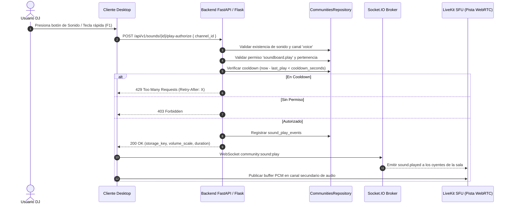

# C.C.I. SYSTEM — CCI COMMUNITIES
## Fase 4: Sound Deck (Botonera de Sonidos Compartida)

**Versión:** 1.0  
**Fecha:** 2026-11-06  
**Subsistema:** CCI Communities — Sound Deck & Soundboard  
**Estado:** IMPLEMENTADO Y VERIFICADO (Fase 4)  
**Rama:** `feature/communities-phase0-design`  

---

## 1. Resumen Ejecutivo y Alcance

La Fase 4 de **CCI Communities** implementa la infraestructura completa para la botonera de sonidos (**Sound Deck**) sobre salas de voz en vivo y biblioteca personal/comunitaria:

1. **Tres Bibliotecas Segregadas (Scopes):**
   - **CCI Sounds (Global):** Pistas de audio provistas por la plataforma (`owner_type = 'global'`), administradas exclusivamente por administradores del sistema.
   - **Mis Sonidos (Personal):** Biblioteca privada del usuario (`owner_type = 'user'`), accesible únicamente por su creador, con cuota máxima de 50 sonidos.
   - **Sonidos de Comunidad:** Biblioteca específica de cada comunidad (`owner_type = 'community'`), administrable mediante el permiso `soundboard.manage`.

2. **Validación Técnica Estricta de Audio MP3:**
   - Inspección binaria de magic bytes: cabeceras ID3v2 (`ID3`) y palabras de sincronía MPEG Audio Layer III (`0xFF 0xFB/0xFA/0xF3/0xF2`).
   - Límite estricto de tamaño: máximo **5 MB** (5.242.880 bytes).
   - Límite estricto de duración: máximo **15.0 segundos**.
   - Integridad criptográfica mediante cálculo de hash **SHA-256**.

3. **Control Anti-Spam y Rate Limiting (Cooldown):**
   - Cooldown configurable por sonido (por defecto 5 segundos).
   - Verificación cronológica en base de datos (`sound_play_events`).
   - Rechazo inmediato con HTTP **429 Too Many Requests** y cabecera estándar `Retry-After` ante reintentos prematuros.

4. **Favoritos y Teclas Rápidas (Hotkeys):**
   - Asignación de atajos de teclado personalizados (`hotkey`, e.g. `F1`, `Ctrl+1`) y listado indexado por usuario.

5. **Difusión en Tiempo Real:**
   - Eventos de señalización vía Socket.IO (`sound.played`, `sound.stopped`) hacia la sala WebRTC activa.

---

## 2. Diagrama de Secuencia de Reproducción Autorizada

---

## 3. Catálogo de Endpoints REST (OpenAPI 3.1)

| Método | Endpoint | Permiso requerido | Descripción |
|---|---|---|---|
| `POST` | `/api/v1/sounds/categories` | Admin (global), `soundboard.manage` (comunidad), Dueño (user) | Crea una categoría para organizar sonidos |
| `GET` | `/api/v1/sounds/categories` | Autenticado | Lista categorías filtradas por `scope_type` y `scope_id` |
| `POST` | `/api/v1/sounds` | Admin (global), `soundboard.manage` (comunidad), Usuario regular (user) | Carga y valida un archivo MP3 (JSON base64 o multipart/form-data) |
| `GET` | `/api/v1/sounds` | Autenticado | Lista sonidos con filtros por `owner_type`, `owner_id`, `category_id` y `search` |
| `GET` | `/api/v1/communities/{id}/sounds` | `community.view` | Retorna unión de sonidos de la comunidad + globales + personales del usuario |
| `GET` | `/api/v1/sounds/{id}` | `community.view` o dueño | Obtiene metadatos detallados de un sonido |
| `PATCH` | `/api/v1/sounds/{id}` | Admin / uploader / `soundboard.manage` | Modifica título, volumen, categoría o cooldown |
| `DELETE` | `/api/v1/sounds/{id}` | Admin / uploader / `soundboard.manage` | Baja lógica (`deleted_at`) del sonido |
| `POST` | `/api/v1/sounds/{id}/favorite` | Autenticado | Alterna estado de favorito y vincula tecla rápida (`hotkey`) |
| `GET` | `/api/v1/sounds/favorites` | Autenticado | Lista los sonidos favoritos y hotkeys del usuario |
| `POST` | `/api/v1/sounds/{id}/play-authorize` | `soundboard.play` en canal de voz | Valida cooldown y autoriza reproducción compartida |

---

## 4. Eventos de Tiempo Real (Socket.IO)

- `community:sound:play`: Emite `sound.played` a la sala `comm_voice_<channel_id>` con datos del sonido (`sound_id`, `title`, `volume_scale`, `user_id`).
- `community:sound:stop`: Emite `sound.stopped` a la sala `comm_voice_<channel_id>` para cortar la reproducción de forma anticipada.

---

## 5. Matriz de Pruebas Unitarias (`test_communities_phase4.py`)

| ID | Caso de Prueba | Resultado |
|---|---|---|
| `test_01` | Creación de categorías y subida exitosa de MP3 (global, personal, comunidad) | **PASS** |
| `test_02` | Rechazo de archivos no MP3 por magic bytes (400 Bad Request) | **PASS** |
| `test_03` | Rechazo de archivos que superan 5 MB (413 Payload Too Large) | **PASS** |
| `test_04` | Rechazo de archivos con duración > 15.0 segundos (400 Bad Request) | **PASS** |
| `test_05` | Segregación de bibliotecas y búsqueda por comunidad y usuario | **PASS** |
| `test_06` | Gestión de favoritos y teclas rápidas (hotkeys) | **PASS** |
| `test_07` | Edición y eliminación con control de permisos (`soundboard.manage` vs uploader) | **PASS** |
| `test_08` | Autorización de reproducción exitosa en sala de voz (200 OK) | **PASS** |
| `test_09` | Control de frecuencia y cooldown anti-spam (429 Too Many Requests con `Retry-After`) | **PASS** |
| `test_10` | Aislamiento fail-closed entre comunidades y rechazo ante falta de `soundboard.play` | **PASS** |

**Resultado:** 10/10 pruebas superadas en 0.241s.
