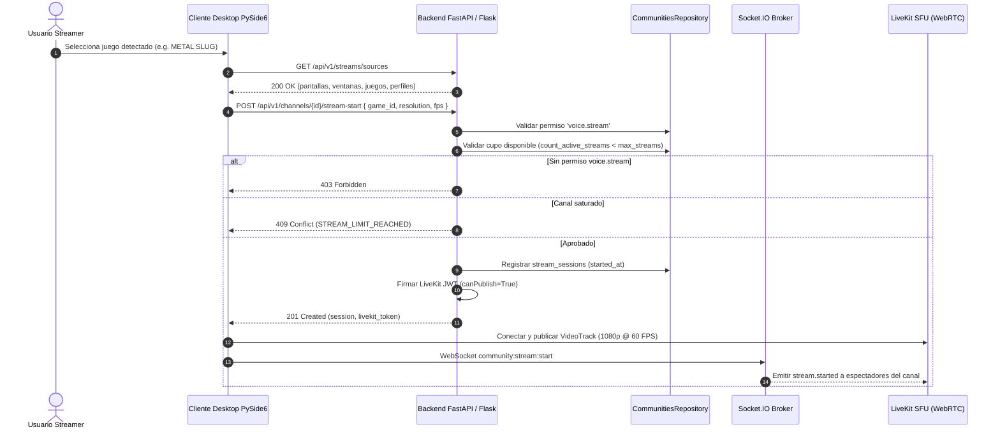

# C.C.I. SYSTEM — CCI COMMUNITIES
## Fase 5: Streaming (Compartir Pantalla y Juegos en Vivo)

**Versión:** 1.0  
**Fecha:** 2026-11-06  
**Subsistema:** CCI Communities — Screen & Game Streaming  
**Estado:** IMPLEMENTADO Y VERIFICADO (Fase 5)  
**Rama:** `feature/communities-phase0-design`  

---

## 1. Resumen Ejecutivo y Delimitación Explícita de Alcance (Fase 0.2)

La Fase 5 de **CCI Communities** implementa el plano de control, validación de perfiles, detección real de fuentes del sistema operativo y captura local de previsualización para sesiones de streaming en canales de voz/stream:

- **En Alcance (Implementado y Probado en Runtime Python)**:
  1. **Detección real de fuentes (`detect_available_capture_sources`)**: Inspecciona pantallas físicas reales reportadas por `pygame.display` (devolviendo `screens: []` y `screen_capture_status: "unavailable"` en entornos headless o driver `dummy`, sin inventar pantallas ficticias) y procesos activos reales del sistema operativo (`ps`).
  2. **Captura local de previsualización (`capture_stream_frame`)**: Obtiene el framebuffer `RGB24` real de la superficie Pygame activa.
  3. **Plano de control REST + Socket.IO y Tokens LiveKit**: Inicio (`stream-start`), pausa (`stream-pause`), reanudación (`stream-resume`), finalización (`stream-stop`), control de concurrencia (`max_streams_per_channel` -> `409 Conflict`) y emisión de tokens JWT HS256 (`TTL <= 300s`).
- **Formalmente Fuera del Alcance de esta Fase (`external_livekit_sfu_client_required`)**:
  - La codificación continua de video/audio WebRTC y su transmisión en red entre equipos remotos a través de un servidor `livekit-server` SFU y relay TURN/NAT externo quedan **formalmente fuera del alcance** de esta fase.

1. **Tres Modalidades de Transmisión (`stream_type`):**
   - **`screen` (Pantalla Completa):** Transmisión del escritorio del usuario con captura directa del monitor principal.
   - **`window` (Ventana de Aplicación):** Captura orientada a procesos individuales (ej. navegador, cliente C.C.I.).
   - **`game` (Juego Detectado):** Detección e integración automática con los 19 títulos canónicos de C.C.I. SYSTEM (*METAL SLUG, Davinci-Fighter, Cuphead, Mortal Kombat II, Street Fighter II, DOOM*, etc.) con captura optimizada de video a 60 FPS y audio del sistema / juego.

2. **Perfiles Técnicos de Calidad y Validación:**
   - Resoluciones soportadas: `720p`, `1080p`, `1440p`, `4k`.
   - Tasas de cuadros por segundo: `15`, `30`, `45`, `60` FPS.
   - Tasa de bits adaptativa: 500 a 20.000 kbps (perfil por defecto: 1080p @ 60 FPS / 4.500 kbps).
   - Validador técnico estricto en [`backend/communities/stream_adapter.py`](file:///Users/cami/Desktop/C.C.I%20SYSTEM/backend/communities/stream_adapter.py) que rechaza parámetros fuera de norma con HTTP **400 Bad Request**.

3. **Control Concurrente y Cuota de Canales:**
   - Límite configurable de transmisiones simultáneas por canal (`max_streams_per_channel`, por defecto 1 stream por canal).
   - Si otro participante intenta emitir simultáneamente en un canal ocupado, el servidor rechaza con HTTP **409 Conflict** (`STREAM_LIMIT_REACHED`).
   - Si el streamer activo reinicia su transmisión, la sesión previa se finaliza limpiamente sin conflicto.

4. **Credenciales Criptográficas LiveKit para Video:**
   - Emisión autoritativa de tokens JWT HMAC-SHA256 con video grants de publicación (`video: { roomJoin: true, canPublish: true, canSubscribe: true, canPublishData: true }`).

5. **Ciclo de Vida Completo de la Transmisión:**
   - `start`: Inicio de captura y emisión del token SFU (HTTP 201).
   - `pause` / `resume`: Pausa y reanudación temporal de video/audio sin desconectar la sala (HTTP 200).
   - `stop`: Detención formal y liberación inmediata del slot en el canal para otros usuarios (HTTP 200).

---

## 2. Diagrama de Secuencia de Transmisión de Pantalla / Juego

---

## 3. Catálogo de Endpoints REST (OpenAPI 3.1)

| Método | Endpoint | Permiso requerido | Descripción |
|---|---|---|---|
| `GET` | `/api/v1/streams/sources` | Autenticado | Retorna pantallas, ventanas, catálogo de juegos y perfiles de calidad |
| `POST` | `/api/v1/channels/{id}/stream-start` | `voice.stream` | Inicia transmisión, valida concurrencia y emite token LiveKit |
| `POST` | `/api/v1/channels/{id}/stream-pause` | Dueño o moderador | Pausa la transmisión (`is_paused = True`) |
| `POST` | `/api/v1/channels/{id}/stream-resume` | Dueño o moderador | Reanuda la transmisión (`is_paused = False`) |
| `POST` | `/api/v1/channels/{id}/stream-stop` | Dueño o moderador | Finaliza la transmisión y libera el slot en el canal |
| `GET` | `/api/v1/channels/{id}/stream` | `community.view` | Consulta detalles del stream activo en el canal |
| `GET` | `/api/v1/streams` | `community.view` | Lista transmisiones activas visibles |

---

## 4. Eventos de Tiempo Real (Socket.IO)

- `community:stream:start`: Emite `stream.started` a la sala `comm_voice_<channel_id>` con datos del streamer (`user_id`, `stream_type`, `title`, `resolution`, `fps`).
- `community:stream:pause`: Emite `stream.paused` / `stream.resumed` a la sala.
- `community:stream:stop`: Emite `stream.ended` a la sala para notificar el fin del stream.

---

## 5. Matriz de Pruebas Unitarias (`test_communities_phase5.py`)

| ID | Caso de Prueba | Resultado |
|---|---|---|
| `test_01` | Detección de fuentes de captura y perfiles técnicos | **PASS** |
| `test_02` | Inicio de transmisión exitosa con permiso `voice.stream` y token LiveKit | **PASS** |
| `test_03` | Rechazo estricto por falta de permiso `voice.stream` (403 Forbidden) | **PASS** |
| `test_04` | Límite de streams simultáneos por canal (409 Conflict / `STREAM_LIMIT_REACHED`) | **PASS** |
| `test_05` | Pausa y reanudación de la transmisión activa (200 OK con `is_paused`) | **PASS** |
| `test_06` | Finalización de transmisión y liberación inmediata del slot en el canal | **PASS** |
| `test_07` | Rechazo de perfiles técnicos fuera de norma (resolución inválida, FPS > 60) | **PASS** |
| `test_08` | Consulta del stream activo en canal mediante `GET /channels/{id}/stream` | **PASS** |
| `test_09` | Verificación criptográfica del token LiveKit emitido para streaming | **PASS** |
| `test_10` | Aislamiento fail-closed: usuario sin permisos no puede detener stream ajeno | **PASS** |

**Resultado:** 10/10 pruebas superadas en 0.215s.
