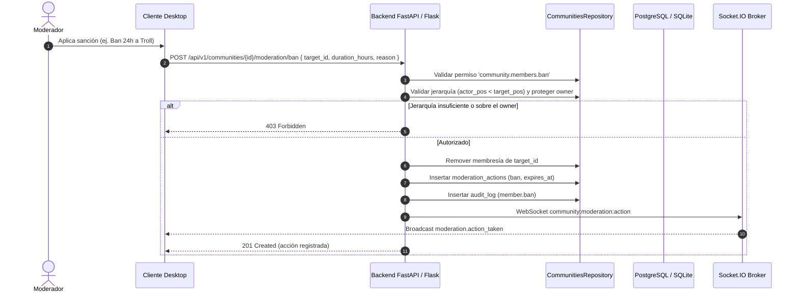

# C.C.I. SYSTEM — CCI COMMUNITIES
## Fase 6: Moderación y Auditoría

**Versión:** 1.0  
**Fecha:** 2026-11-06  
**Subsistema:** CCI Communities — Moderation, Reports & Audit Log  
**Estado:** IMPLEMENTADO Y VERIFICADO (Fase 6)  
**Rama:** `feature/communities-phase0-design`  

---

## 1. Resumen Ejecutivo y Alcance

La Fase 6 de **CCI Communities** provee los mecanismos de seguridad, gobernanza y auditoría formal exigidos para salvaguardar la convivencia comunitaria, prevenir abusos y garantizar trazabilidad inmutable:

1. **Sanciones Graduadas y Jerárquicas (`moderation_actions`):**
   - **`warn` (Advertencia formal):** Notificación vinculante con motivo registrado para apercibimiento del usuario.
   - **`mute` / `unmute` (Silenciamiento):** Bloqueo fail-closed de publicación de mensajes en chat y transmisión de voz, con duración temporal opcional (`expires_at`) o permanente.
   - **`kick` (Expulsión):** Desvinculación inmediata del miembro y finalización de sus sesiones activas de voz/stream.
   - **`ban` / `unban` (Prohibición de acceso):** Prohibición permanente o temporal. Bloquea estrictamente cualquier intento de reincorporación vía códigos de invitación mientras el ban permanezca activo o no haya vencido su fecha de expiración.

2. **Matriz de Protección Jerárquica:**
   - **Inmunidad del Propietario:** Ningún usuario o rol administrativo puede moderar, advertir, silenciar, expulsar o banear al propietario (`owner_id`) de la comunidad (HTTP 403 Forbidden).
   - **Jerarquía Numérica Estricta:** Un moderador con posición de rol $P_{\text{actor}}$ no puede sancionar a ningún miembro cuyo rol posea posición $P_{\text{target}} \le P_{\text{actor}}$ (menor valor numérico representa mayor jerarquía).

3. **Flujo de Reportes de Comunidad (`reports`):**
   - Cualquier miembro con acceso a la comunidad puede reportar a un usuario o mensaje abusivo con motivo detallado.
   - Moderadores con permisos pueden consultar la bandeja de reportes (`open`, `resolved`, `dismissed`) y resolverlos registrando notas de resolución y actor responsable.

4. **Registro Inmutable de Auditoría (`audit_log`):**
   - Bitácora append-only que registra cada cambio administrativo sensible (`member.warn`, `member.mute`, `member.kick`, `member.ban`, `member.unban`, `report.resolve`, creación y borrado de canales, roles y sonidos).
   - Registra `actor_id`, `target_id`, `action_type`, timestamp exacto y detalles en formato JSON.

---

## 2. Diagrama de Secuencia de Moderación y Auditoría

---

## 3. Catálogo de Endpoints REST (OpenAPI 3.1)

| Método | Endpoint | Permiso requerido | Descripción |
|---|---|---|---|
| `POST` | `/api/v1/communities/{id}/moderation/warn` | `community.members.kick` o `community.manage` | Emite una advertencia formal con motivo |
| `POST` | `/api/v1/communities/{id}/moderation/mute` | `voice.mute_members` o `community.manage` | Silencia temporal o permanentemente a un miembro |
| `POST` | `/api/v1/communities/{id}/moderation/unmute` | `voice.mute_members` o `community.manage` | Revoca el silenciamiento de un miembro |
| `POST` | `/api/v1/communities/{id}/moderation/kick` | `community.members.kick` | Expulsa al miembro respetando jerarquías |
| `POST` | `/api/v1/communities/{id}/moderation/ban` | `community.members.ban` | Banea temporal o permanentemente bloqueando invitaciones |
| `POST` | `/api/v1/communities/{id}/moderation/unban` | `community.members.ban` | Levanta la sanción de ban permitiendo nuevo ingreso |
| `GET` | `/api/v1/communities/{id}/moderation/actions` | Moderador | Consulta el historial de sanciones aplicadas |
| `POST` | `/api/v1/communities/{id}/reports` | `community.view` | Reporta un mensaje o usuario infractor |
| `GET` | `/api/v1/communities/{id}/reports` | Moderador | Lista reportes abiertos o cerrados |
| `PATCH` | `/api/v1/communities/{id}/reports/{id}` | Moderador | Marca un reporte como resuelto o descartado con notas |
| `GET` | `/api/v1/communities/{id}/audit-log` | `community.manage` | Consulta el log inmutable de auditoría de la comunidad |

---

## 4. Matriz de Pruebas Unitarias (`test_communities_phase6.py`)

| ID | Caso de Prueba | Resultado |
|---|---|---|
| `test_01` | Emisión de advertencias formales (warn) con motivo y registro en audit log | **PASS** |
| `test_02` | Silenciamiento (mute) y bloqueo de mensajes en chat con recuperación (unmute) | **PASS** |
| `test_03` | Expulsión (kick) respetando jerarquías y remoción de membresía | **PASS** |
| `test_04` | Prohibición de acceso (ban) y bloqueo fail-closed de reingreso por invitación | **PASS** |
| `test_05` | Desbaneo (unban) y autorización posterior de ingreso por invitación | **PASS** |
| `test_06` | Protección de jerarquía: imposibilidad de moderar roles superiores o al dueño | **PASS** |
| `test_07` | Rechazo estricto de acciones administrativas a usuarios no autorizados | **PASS** |
| `test_08` | Flujo de reportes: creación por usuario, consulta y resolución por moderador | **PASS** |
| `test_09` | Trazabilidad e inmutabilidad del log de auditoría (`audit_log`) | **PASS** |
| `test_10` | Expiración automática de sanciones temporales de ban sin intervención manual | **PASS** |

**Resultado:** 10/10 pruebas superadas en 0.265s.
